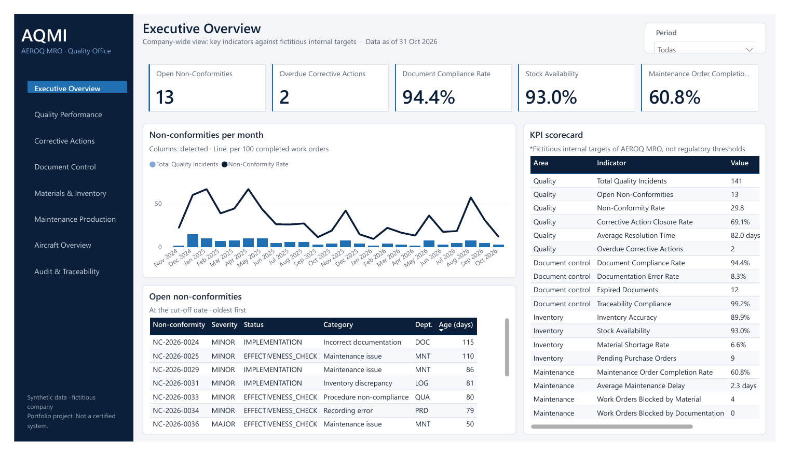
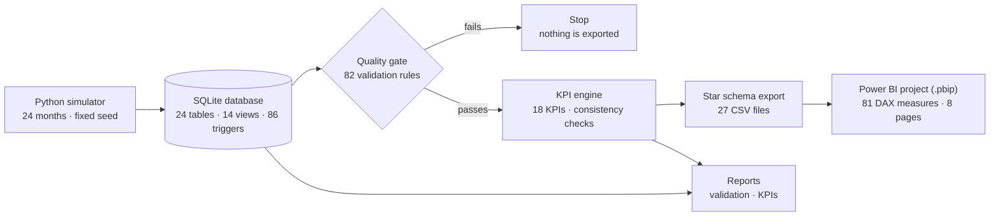
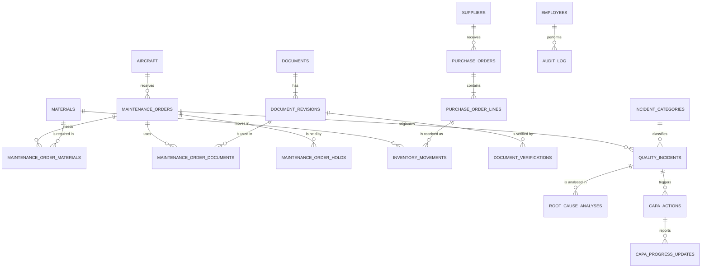
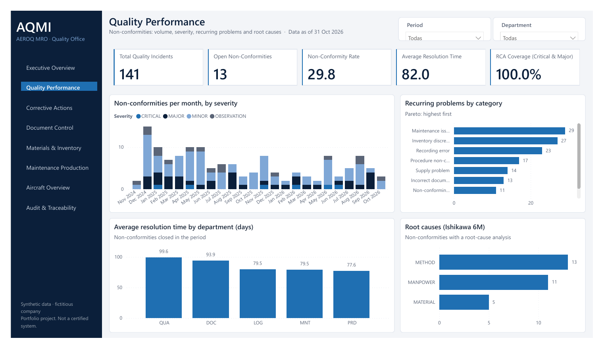
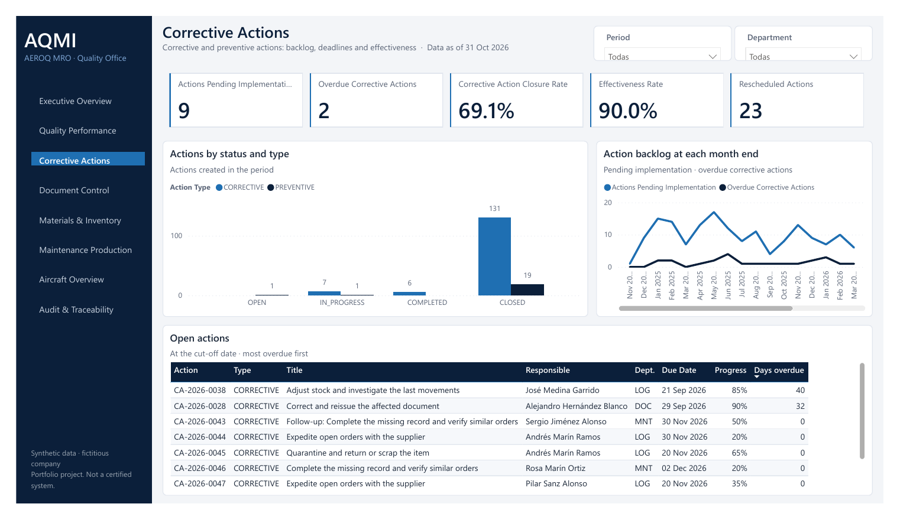
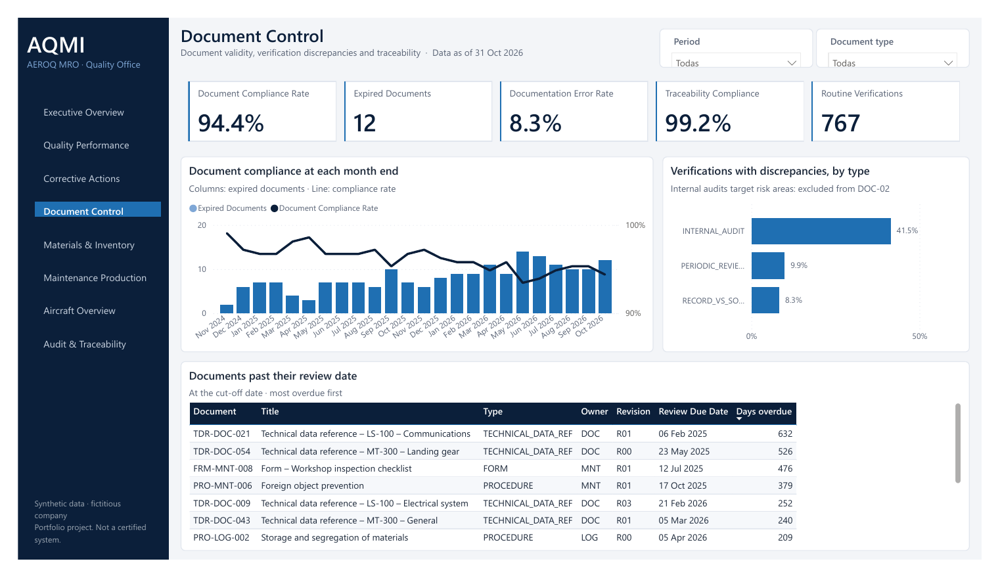
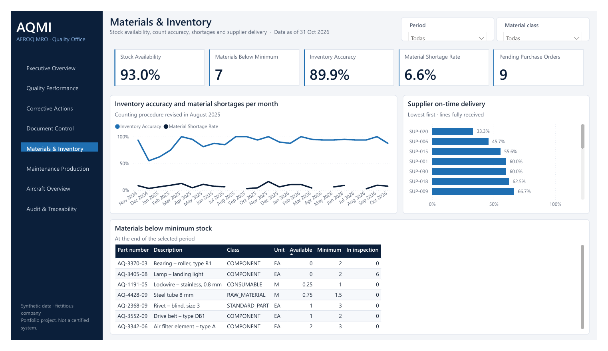
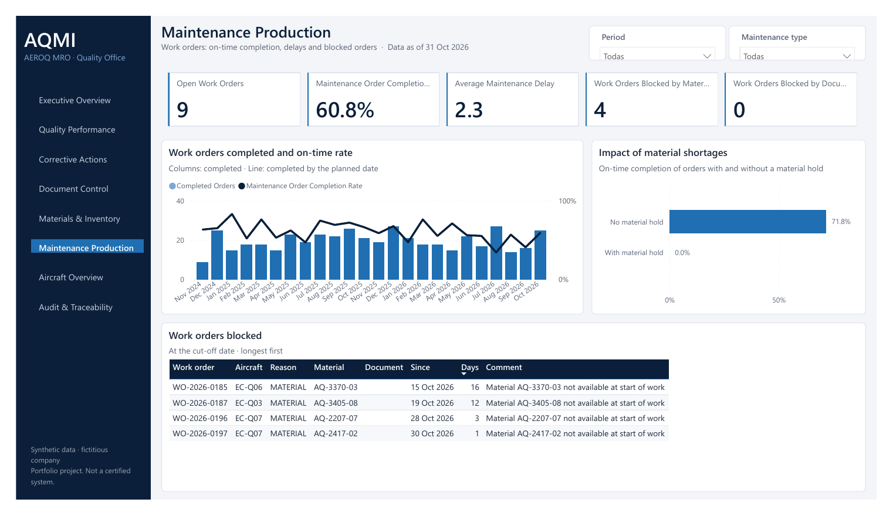
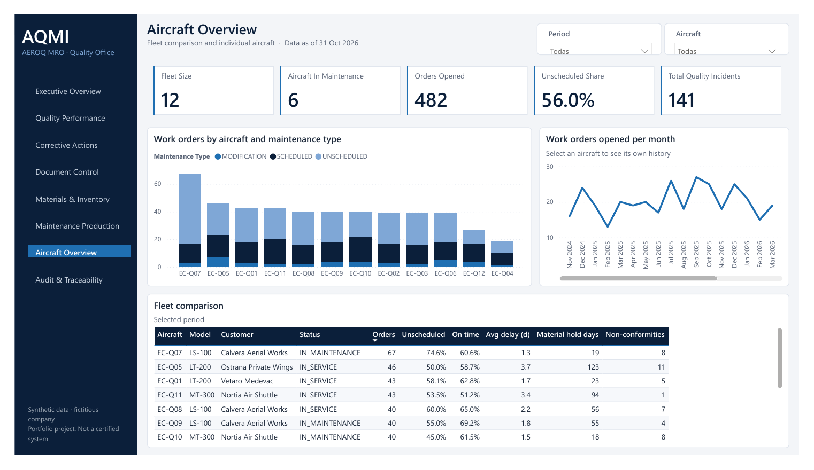
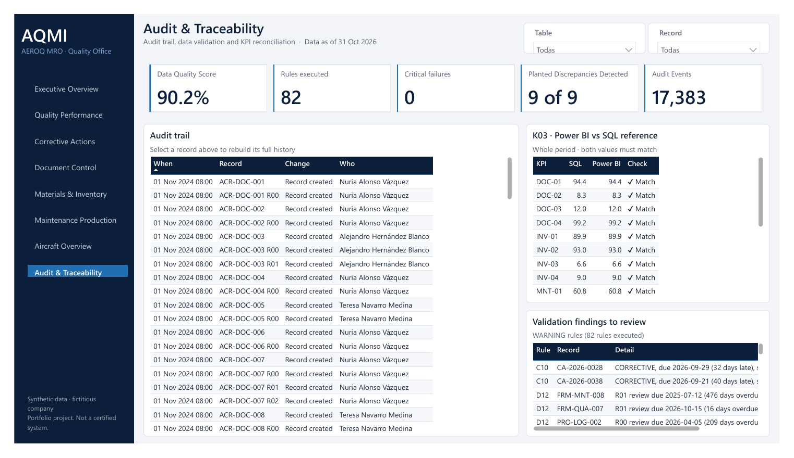

<h1 align="center">Aviation Quality &amp; Maintenance Intelligence (AQMI)</h1>

<p align="center">
  <strong>A quality-management and production-control system for a civil helicopter MRO — database, process controls, traceability, KPIs and Power BI dashboards.</strong>
</p>

<p align="center">
  <a href="https://github.com/DeLabFuente/aviation-quality-maintenance-intelligence/actions/workflows/tests.yml"></a>
  
  
  
  
  <a href="LICENSE"></a>
</p>

> **Portfolio project with synthetic data.** AEROQ MRO is a fictitious company and every record in this repository is synthetic. AQMI is not certified, does not demonstrate compliance with any regulation, and AEROQ MRO holds no real approval. See [Synthetic data and disclaimer](#synthetic-data-and-disclaimer).

<p align="center">
  
</p>

---

## Contents

[Overview](#overview) · [What this project demonstrates](#what-this-project-demonstrates) · [Objectives](#objectives) · [Features](#features) · [Architecture](#architecture) · [Tech stack](#tech-stack) · [Data model](#data-model) · [Quality controls](#quality-controls) · [KPIs](#kpis) · [Dashboards](#dashboards-screenshots) · [Case study](#case-study) · [What the data shows](#what-the-data-shows) · [Regulatory context](#regulatory-context) · [Getting started](#getting-started-installation) · [Repository structure](#repository-structure) · [Methodology](#methodology) · [Limitations](#limitations) · [Disclaimer](#synthetic-data-and-disclaimer) · [About the author](#about-the-author)

## Overview

**AEROQ MRO** is a fictitious maintenance organisation that carries out scheduled and unscheduled maintenance on a fleet of 12 civil helicopters for four operators. **AQMI** models the administrative side of its quality and production-control office:

- non-conformities are detected, classified, investigated and closed;
- every non-conformity can lead to corrective and preventive actions (CAPA) whose effectiveness is verified before closure;
- controlled documents have revisions, review dates and verifications;
- stores receive, reserve, block and issue materials against maintenance orders;
- maintenance orders are followed from opening to closure, including the holds caused by missing material or documentation;
- every change is written to an audit trail, so the history of any record can be rebuilt.

It is **not just a dashboard**. A relational database enforces the business rules, a simulator produces 24 months of coherent activity, a quality gate checks the data before anything is reported, and a Power BI layer turns it into indicators for management.

## What this project demonstrates

| Competence (quality / production-control office) | Where to see it |
|---|---|
| Non-conformity management: classification, severity, ownership, status workflow | `Quality_Incidents` table and its rules · [case study](documentation/case_study_nonconformity.md) |
| Root-cause analysis (5 Why, Ishikawa) and CAPA follow-up up to effectiveness verification | `Root_Cause_Analyses`, `CAPA_Actions` · *Corrective Actions* page |
| Document control: revisions, validity, expired documents still in use | `Documents`, `Document_Revisions` · [query 06](sql/queries/06_expired_documents_in_use.sql) · *Document Control* page |
| Data verification: checking records against their source and requesting corrections | `Document_Verifications` · 82 [validation rules](sql/validation) |
| Traceability from supplier to aircraft | [query 02](sql/queries/02_lot_traceability.sql) · `Audit_Log` · *Audit & Traceability* page |
| Stores and materials control: stock by status, minimum stock, pending orders, shortages | `Inventory_Movements`, `Purchase_Orders` · *Materials & Inventory* page |
| Maintenance-order follow-up: delays, holds by material or documentation | `Maintenance_Orders`, `Maintenance_Order_Holds` · *Maintenance Production* page |
| KPI design and reporting for management | [18 KPI definitions](documentation/07_fase6_indicadores.md) · [KPI report](reports/kpi_report.md) · 8 dashboards |
| Continuous improvement: measuring whether an action worked | [What the data shows](#what-the-data-shows) |

## Objectives

1. Register and manage non-conformities, classified by nature and severity.
2. Investigate root causes and follow corrective and preventive actions to a verified closure.
3. Control technical and administrative documents, their validity and their traceability.
4. Control materials and stock, and identify supply problems before they stop the work.
5. Relate every non-conformity to the aircraft, maintenance order, document, material or supplier involved.
6. Measure process performance with indicators, detect trends and recurring problems, and support decisions with reports and dashboards.
7. Apply to the project itself the same rigour expected from a quality office: validated data, tests and documented decisions.

## Features

| Module | What it does |
|---|---|
| **A — Quality management** | Non-conformities with unique number (`NC-YYYY-NNNN`), 8 categories, severity (observation / minor / major / critical), priority, responsible department and owner, containment, target closure date and closure summary. Status workflow from *open* to *closed*. |
| **B — Corrective and preventive actions** | Actions linked to the non-conformity, responsible person, due date and rescheduling history, progress updates, overdue detection, independent effectiveness verification and formal closure. Root-cause analysis by 5 Why or Ishikawa category. |
| **C — Document control** | 250 controlled documents with 602 revisions: issue, effective and review dates, superseded revisions, verifications and who performed them. Detects expired documents and documents used after expiry. |
| **D — Materials and inventory** | 100 part numbers, 40 suppliers, purchase orders and lines, receipts with release certificate, stock by status (available, reserved, quarantine, blocked, non-conforming), stock counts and minimum stock. Stock is always calculated from movements, never stored. |
| **E — Maintenance and production control** | 491 maintenance orders (scheduled and unscheduled): planned and actual dates, documents and materials required, holds by material or documentation. No engineering or airworthiness calculations: only administrative control. |
| **F — Audit and traceability** | 86 triggers write every insert and update into `Audit_Log` (17,383 events): who, when, which field, old and new value. Any record's history can be rebuilt, and incomplete records are detected by the validation rules. |

## Architecture



One command runs the whole chain: `python scripts/run_pipeline.py`. Every step is deterministic: the same seed always produces exactly the same data, the same findings and the same indicators.

## Tech stack

| Technology | Used for | Why |
|---|---|---|
| **Python 3.12** | Simulator, pipeline, validation and KPI engines, exports, checks | Readable, standard in data work, no heavy framework needed |
| **SQL / SQLite** | Relational database with `STRICT` tables, constraints, triggers and views | A single file, nothing to install, real SQL; the schema can move to PostgreSQL later |
| **Power BI Desktop + DAX** | Semantic model (star schema) and 8 dashboards | The reporting tool most used in industry |
| **Power BI Project (.pbip): TMDL + PBIR** | Model and report stored as text files | Every measure and visual can be reviewed in Git, unlike a binary `.pbix` |
| **pytest** | 150+ automated tests | Proves that rules, KPIs and exports behave as documented |
| **GitHub Actions** | Runs the pipeline and the tests on Linux and Windows on every push | Anyone can see that the project works on a clean machine |
| **Markdown + Mermaid** | Documentation and diagrams | Rendered directly by GitHub |
| **CSV / Excel** | Data exchange (synthetic tables, Power BI source) | Open formats any office can read |

## Data model

24 tables in third normal form, organised by module. Every foreign key is enforced, every status has a `CHECK` constraint, and dates are validated (for example, an action cannot be verified before it is completed, and the verifier cannot be the person responsible for the action). Simplified core:



Full definitions: [data dictionary](documentation/02_diccionario_de_datos.md) and [business rules](documentation/03_reglas_de_negocio.md) (Spanish). For Power BI the data is reshaped into a **star schema**: 9 dimensions, 17 fact tables (including monthly snapshots of actions, stock, purchase orders and documents) and 41 single-direction relationships.

## Quality controls

The project applies to its own data the controls a quality office applies to real records.

| Control | What it checks | Result |
|---|---|---|
| **Database constraints** | Keys, allowed values, date order, closure prerequisites | Invalid records cannot be saved |
| **Quality gate** — [82 rules](sql/validation) | Integrity, completeness, duplicates, coherence between modules, process compliance | 0 critical failures · Data Quality Score 90.2 % · [report](reports/validation_report.md) |
| **Planted discrepancies** | The simulator plants 9 known errors; the rules must find exactly those 9 | 9 of 9 detected, no false positives in those rules |
| **KPI checks** (K01–K05) | Monthly values add up to the totals, rebuilt history matches the current state, Power BI matches SQL | All passed · [report](reports/kpi_report.md) |
| **Power BI project check** | TMDL syntax, every DAX reference, unambiguous relationships, every field used by every visual, official Microsoft JSON schemas | `POWER BI PROJECT OK` |
| **Automated tests** | 150+ tests, including negative tests that inject defects and expect them to be caught | Run on every push by GitHub Actions |
| **Pre-publication check** | Required files, README sections, broken links, placeholders, personal paths, file sizes | `python scripts/check_release.py` |

## KPIs

18 indicators in four areas. Each one is defined once, as an SQL query in [`sql/kpi`](sql/kpi), with what it measures, exact formula, tables, frequency, interpretation and limitations ([full definitions](documentation/07_fase6_indicadores.md), Spanish). Values for the whole period (Nov 2024 – Oct 2026), or at the cut-off date (31 Oct 2026) for state indicators:

| Area | KPI | Value | Target* | Status |
|---|---|---:|---:|:---:|
| Quality | Total Quality Incidents | 141 | — | — |
| Quality | Open Non-Conformities | 13 | — | — |
| Quality | Non-Conformity Rate (per 100 orders) | 29.8 | — | — |
| Quality | Corrective Action Closure Rate (on time) | 69.1 % | ≥ 85 % | 🔴 |
| Quality | Average Resolution Time | 82.0 days | ≤ 75 | 🟠 |
| Quality | Overdue Corrective Actions | 2 | 0 | 🟠 |
| Document control | Document Compliance Rate | 94.4 % | ≥ 95 % | 🟠 |
| Document control | Documentation Error Rate | 8.3 % | ≤ 5 % | 🔴 |
| Document control | Expired Documents | 12 | 0 | 🔴 |
| Document control | Traceability Compliance | 99.2 % | 100 % | 🟠 |
| Inventory | Inventory Accuracy | 89.9 % | ≥ 95 % | 🔴 |
| Inventory | Stock Availability | 93.0 % | ≥ 95 % | 🟠 |
| Inventory | Material Shortage Rate | 6.6 % | ≤ 5 % | 🟠 |
| Inventory | Pending Purchase Orders | 9 | — | — |
| Maintenance | Maintenance Order Completion Rate (on time) | 60.8 % | ≥ 85 % | 🔴 |
| Maintenance | Average Maintenance Delay | 2.3 days | ≤ 2 | 🟠 |
| Maintenance | Work Orders Blocked by Material | 4 | — | — |
| Maintenance | Work Orders Blocked by Documentation | 0 | — | — |

\* **Fictitious internal targets of AEROQ MRO**, set before the values were calculated. They are not regulatory thresholds. 🟠 = within the fictitious warning band, 🔴 = beyond it.

- *State* indicators (open, overdue, blocked) can be rebuilt for any past month from the history and the audit trail.
- Every KPI keeps its numerator and denominator, so quarters and years are aggregated correctly; a zero denominator gives "no data", never 0 %.

## Dashboards (screenshots)

The Power BI report has 8 pages with a common layout: navigation bar, page filters, KPI cards, and charts and tables that answer one question each. The model behind them is a star schema with 81 documented DAX measures. A PDF export of the whole report is in [`assets/AQMI_report.pdf`](assets/AQMI_report.pdf).

<table>
  <tr>
    <td width="50%"><br><b>Quality Performance</b> — non-conformities per month by severity, recurring problems by category, root causes (Ishikawa 6M), resolution time by department.</td>
    <td width="50%"><br><b>Corrective Actions</b> — open actions and their owners, actions by status and type, backlog at each month end.</td>
  </tr>
  <tr>
    <td><br><b>Document Control</b> — compliance at each month end, documents past their review date, verifications with discrepancies.</td>
    <td><br><b>Materials &amp; Inventory</b> — inventory accuracy and shortages per month, materials below minimum stock, supplier on-time delivery.</td>
  </tr>
  <tr>
    <td><br><b>Maintenance Production</b> — orders completed and on-time rate, orders blocked and why, impact of material shortages.</td>
    <td><br><b>Aircraft Overview</b> — fleet comparison, work orders by aircraft and maintenance type, monthly activity.</td>
  </tr>
  <tr>
    <td><br><b>Audit &amp; Traceability</b> — audit trail of any record, validation findings and the Power BI vs SQL reconciliation of the 18 KPIs.</td>
    <td><br><b>Executive Overview</b> — KPI scorecard against the fictitious targets, non-conformities per month, open non-conformities.</td>
  </tr>
</table>

## Case study

**[NC-2025-0021 — from detection to verified closure](documentation/case_study_nonconformity.md).** A recording error found during a document verification is followed step by step: investigation, Ishikawa analysis (cause: *method*), corrective action to redesign a work-order closure form, independent effectiveness check and closure in 60 days. The document then checks with data that the measure worked: discrepancies on the closure record fell from 16.5 % to 5.1 % after the new form revision. It is generated from the database, and a test keeps it identical to the data.

## What the data shows

The simulator contains four patterns introduced **on purpose** (and documented as such), so that the analysis has causes and effects to find:

| Pattern | Before | Measure | After |
|---|---|---|---|
| Supplier with recurrent late deliveries | ~82 % late deliveries (others ~25 %) | Supplier improvement plan, status *conditional* | ~28 % late; supplier approved again |
| Badly designed work-order closure form | ~16 % of records with discrepancies | Corrective action and new form revision | ~5 % |
| Stock counts of standard parts | ~30 % of counts with differences (others ~6 %) | Revised counting procedure | ~5 % |
| One helicopter with more failures | 75 % of its orders unscheduled (fleet ~53 %) | — (fleet comparison) | — |

One finding was **not** planted: the 69 maintenance orders that had a material hold were completed on time **0 %** of the time, against 71.8 % for the rest. In this dataset, a material hold is the clearest warning sign that an order will finish late.

## Regulatory context

AQMI uses the European framework for maintenance organisations only as **context**: it illustrates concepts, and it does not implement or demonstrate compliance with any requirement.

| Real-world context (official source) | Demonstrative feature in AQMI |
|---|---|
| Part-145 is Annex II to Regulation (EU) No 1321/2014 and sets the requirements for approved maintenance organisations. | General scenario of AEROQ MRO (a **fictitious** organisation with **no** approval). |
| Regulation (EU) 2021/1963 introduced a management system in Part-145 (point 145.A.200), applicable since 2 December 2022. | Non-conformity → root cause → CAPA → effectiveness cycle, and the indicators that follow it. |
| 145.A.202 deals with the internal safety reporting system. | Incident register (AQMI is **not** a safety reporting system). |
| 145.A.42 deals with the classification of components and the segregation of unserviceable components. | Stock statuses *quarantine*, *blocked* and *non-conforming*. |
| 145.A.55 deals with maintenance records. | Traceability of each order's documentation and the audit trail. |
| AESA is the competent authority for maintenance organisations whose principal place of business is in Spain. | Geographic context of the scenario. |

Sources: [EASA Easy Access Rules for Continuing Airworthiness (Part-145)](https://www.easa.europa.eu/en/easy-access-rules/95cada/ERULES-1963177438-319) · [EASA guide on Part-145 after Regulation (EU) 2021/1963](https://www.easa.europa.eu/en/downloads/136744/en) · [Regulation (EU) 2021/1963 (Spanish edition, BOE)](https://boe.es/doue/2021/400/L00018-00051.pdf) · [AESA — maintenance organisations](https://www.seguridadaerea.gob.es/es/node/1275)

## Getting started (installation)

**Requirements:** Python 3.12 or later (it includes SQLite 3.37+, needed for `STRICT` tables) and, for the dashboards, [Power BI Desktop](https://www.microsoft.com/power-platform/products/power-bi/desktop) on Windows.

```powershell
git clone https://github.com/DeLabFuente/aviation-quality-maintenance-intelligence.git
cd aviation-quality-maintenance-intelligence
python -m venv .venv
.venv\Scripts\activate                      # macOS / Linux: source .venv/bin/activate
pip install -r requirements.txt

python scripts/run_pipeline.py              # database, 24-month simulation, quality gate, KPIs, Power BI export
python -m pytest -q                         # automated tests
python scripts/set_powerbi_data_folder.py   # points Power BI to data/processed on this computer
```

Then open `powerbi/AQMI.pbip` in Power BI Desktop and press **Refresh**.

- **Only the dashboards, without Python:** the CSV files are already in [`data/processed`](data/processed). Open `powerbi/AQMI.pbip`, go to *Transform data → Edit parameters*, set `DataFolder` to the full path of `data\processed\` (ending with a backslash) and press **Refresh**.
- **Only the data:** the 24 tables of the database are also in [`data/synthetic`](data/synthetic) as CSV files.
- A beginner-friendly, step-by-step guide (Spanish) is in the [Phase 3 document](documentation/04_fase3_entorno_y_base_de_datos.md).

## Repository structure

```text
├── config/            settings.py (paths, cut-off date, seed) and simulator parameters
├── data/
│   ├── synthetic/     the 24 database tables as CSV, plus the list of planted discrepancies
│   └── processed/     star schema exported for Power BI (27 CSV files)
├── database/          aqmi.db, rebuilt by the pipeline (not stored in Git)
├── documentation/     one document per phase, case study, data dictionary, business rules
├── powerbi/           AQMI.pbip: semantic model (TMDL) and report (PBIR)
├── reports/           validation report, KPI report, pre-publication check
├── scripts/           pipeline, simulator, validation and KPI engines, exports, checks
├── sql/
│   ├── schema/        tables, indexes, triggers and reference data
│   ├── views/         14 business views
│   ├── validation/    82 validation rules, one file each
│   ├── queries/       8 business queries a quality office would ask
│   ├── kpi/           18 KPI reference queries
│   └── analytics/     22 star-schema queries for Power BI
├── tests/             automated tests and Microsoft's official Power BI JSON schemas
└── assets/            screenshots and PDF export of the dashboards
```

## Methodology

The project was built in nine phases, each closed with its own document, its tests and an explicit approval before the next one started:

| Phase | Scope | Document (Spanish) |
|---|---|---|
| 1 | Scope, architecture and overall design | [01](documentation/01_fase1_alcance_y_arquitectura.md) |
| 2 | Relational model, data dictionary and business rules | [02](documentation/02_diccionario_de_datos.md) · [03](documentation/03_reglas_de_negocio.md) |
| 3 | Database creation (SQLite) and environment guide | [04](documentation/04_fase3_entorno_y_base_de_datos.md) |
| 4 | Coherent synthetic data (discrete-event simulation) | [05](documentation/05_fase4_datos_sinteticos.md) |
| 5 | SQL queries and validation rules (quality gate) | [06](documentation/06_fase5_consultas_y_validaciones.md) |
| 6 | KPIs | [07](documentation/07_fase6_indicadores.md) |
| 7 | Power BI model and dashboards | [08](documentation/08_fase7_power_bi.md) |
| 8 | Documentation and GitHub presentation | [09](documentation/09_fase8_documentacion_y_github.md) |
| 9 | Final tests and professional review | — |

Principles applied throughout:

- **Simulate, don't randomise.** The data comes from a chronological simulation of the company, so every record has a cause: an order needs a material, the material is ordered, received, inspected and issued; a discrepancy found in a check opens a non-conformity, and so on.
- **One source of truth for each figure.** Stock is calculated from movements; each KPI is defined once in SQL and Power BI is reconciled against it.
- **Check before reporting.** Nothing reaches the dashboards unless the quality gate passes.
- **Reproducible.** Fixed seed and fixed cut-off date (31 Oct 2026): the same command gives the same result on any computer.
- **Honest about limits.** Planted patterns are documented, targets are labelled fictitious, regulation is context only.

## Limitations

- **Synthetic data.** The data is coherent by construction but simulated. Real records would be less tidy, and the four planted patterns are deliberately clearer than reality.
- **Not an operational system.** There is no user interface to enter or approve records; activity is produced by the simulator. A web front end was left out of scope on purpose.
- **Administrative control only.** No engineering, airworthiness or maintenance-programme logic, and no technical data about real aircraft types.
- **Fictitious targets.** KPI targets and warning bands are internal assumptions of a fictitious company.
- **Single user, single file.** SQLite suits a demonstration. A multi-user deployment would need a server database (the schema is written to move to PostgreSQL) and user management.
- **Power BI Desktop is required** to open the dashboards (Windows). The project files are checked automatically, but how the dashboards look can only be judged by opening them.
- **Fixed cut-off date.** "Today" is always 31 Oct 2026, so overdue and expired items do not change with the real calendar.

## Synthetic data and disclaimer

AEROQ MRO is a **fictitious** company. All people, aircraft registrations, suppliers, documents and records in this repository are **synthetic** and generated by code; any resemblance to real organisations or people is coincidental. No real, confidential or restricted information was used, and no information from any military or governmental system.

AQMI is **not certified**, does not represent compliance with EASA Part-145 or any other regulation, and must not be used to manage real maintenance or airworthiness activities. AEROQ MRO holds no approval of any kind. References to regulations are used only as context, with links to their official sources.

## About the author

**DeLabFuente** — I spent around 22 years in the Spanish Armed Forces, including work in a Technical Quality and Production Office supporting aircraft maintenance: verifying records against source documentation, detecting and following up discrepancies, recording and validating data in management systems, and tracking spare-part requests and stock availability. I am not an engineer or a licensed technician. This project shows how I would apply that experience in a civil MRO quality or production-control office.

## License

The code and documentation are released under the [MIT License](LICENSE). The Power BI JSON schemas in [`tests/schemas`](tests/schemas) are © Microsoft, also under the MIT License.
