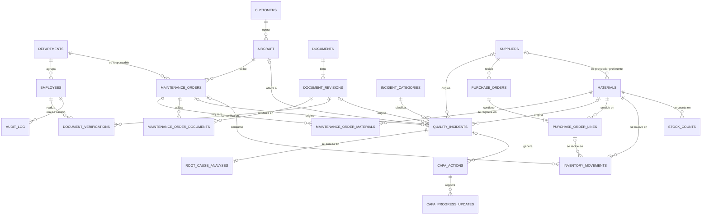

# AQMI — Fase 1: Alcance, arquitectura y diseño general

**Proyecto:** Aviation Quality & Maintenance Intelligence (AQMI)
**Empresa ficticia:** AEROQ MRO
**Documento:** `documentation/01_fase1_alcance_y_arquitectura.md`
**Estado:** Aprobado el 17/11/2026 (decisiones D1–D8 aceptadas; D6 = tipos de helicóptero ficticios)
**Fecha:** 17/11/2026
**Nota:** el modelo de datos detallado de la Fase 2 (`02_diccionario_de_datos.md`) prevalece sobre el modelo preliminar de la sección 4.

> **Aviso.** AEROQ MRO es una empresa ficticia. Todos sus datos internos son sintéticos. AQMI es un proyecto de portfolio: no está certificado, no sustituye a ningún sistema aprobado y AEROQ MRO no tiene ninguna aprobación real. Las referencias a normativa EASA/AESA son **contexto**, no una declaración de cumplimiento.

---

## Índice

0. Resumen para decidir
1. Descripción profesional del sistema
2. Arquitectura general
3. Módulos y relaciones
4. Modelo de datos preliminar
5. Datos sintéticos: enfoque y volúmenes
6. Indicadores (catálogo preliminar)
7. Modelo analítico y cuadros de mando de Power BI
8. Identidad visual
9. Tecnologías
10. Estructura del repositorio
11. Plan de desarrollo por fases
12. Riesgos técnicos y cómo evitarlos
13. Presentación en GitHub ante selección de personal
14. Contexto normativo: qué es requisito y qué es demostrativo
15. Decisiones pendientes de tu aprobación
16. Fuentes

---

## 0. Resumen para decidir

AQMI será un **sistema de información de calidad** para una MRO ficticia de helicópteros. No será solo un dashboard. Tendrá cinco capas: un generador de datos que simula la actividad de la empresa, una base de datos relacional con reglas de integridad, una capa de control que valida los datos antes de usarlos, una capa analítica en modelo estrella y unos cuadros de mando en Power BI.

Como consultor, propongo **siete mejoras** sobre el planteamiento inicial. Todas están justificadas más abajo y necesitan tu aprobación (sección 15):

1. Unificar `Corrective_Actions` y `Preventive_Actions` en una sola tabla `CAPA_Actions`.
2. Separar `Documents` (el documento) de `Document_Revisions` (cada versión).
3. Subir los movimientos de almacén de 600 a unos 3.000, porque 600 no son coherentes con 500 órdenes.
4. Fijar una **fecha de corte** de los datos (31/10/2026) en lugar de usar "hoy".
5. Alimentar Power BI con un **modelo estrella exportado a CSV**, no con una conexión directa a SQLite.
6. Añadir una "puerta de calidad": si los datos no superan las validaciones críticas, no se exportan a Power BI.
7. Mover el repositorio fuera de Dropbox antes de iniciar Git.

---

## 1. Descripción profesional del sistema

**AQMI** es una plataforma de gestión y control de calidad para una organización de mantenimiento de helicópteros civiles. Reproduce el trabajo administrativo de una oficina de calidad y control de producción:

- registro y tratamiento de **no conformidades**;
- **análisis de causa raíz** (5 porqués, Ishikawa);
- **acciones correctivas y preventivas** (CAPA), con verificación de eficacia;
- **control documental** con revisiones, vigencia y verificaciones;
- **control de materiales**: existencias, reservas, cuarentena, material bloqueado y no conforme;
- **seguimiento administrativo** de las órdenes de mantenimiento;
- **trazabilidad y auditoría** de cada cambio;
- **indicadores** y cuadros de mando para la toma de decisiones.

**Lo que AQMI no es:**

- No es un programa de ingeniería de mantenimiento. No calcula intervalos, horas de vuelo, vidas límite ni aeronavegabilidad.
- No es un sistema certificado ni representa el cumplimiento real de ninguna norma.
- No contiene datos reales de ninguna empresa, operador ni de las Fuerzas Armadas.

**Propuesta de valor (para el README):**

> *AQMI demonstrates how an MRO quality office can turn scattered maintenance, document and stores records into a single traceable system: every non-conformity is linked to its aircraft, work order, document revision or material lot, every corrective action is followed until verified effective, and every indicator can be traced back to the records that produced it.*

---

## 2. Arquitectura general

### 2.1 Arquitectura por capas

```
┌──────────────────────────────────────────────────────────────────────┐
│ 1. GENERACIÓN (Python)                                               │
│    Configuración (semilla, fecha de corte, volúmenes)                │
│    → simulador cronológico de la actividad de AEROQ MRO              │
└───────────────────────────────┬──────────────────────────────────────┘
                                ▼
┌──────────────────────────────────────────────────────────────────────┐
│ 2. OPERACIONAL (SQLite, 3.ª forma normal)                            │
│    Tablas, claves, CHECK, índices y triggers de auditoría            │
└───────────────────────────────┬──────────────────────────────────────┘
                                ▼
┌──────────────────────────────────────────────────────────────────────┐
│ 3. CONTROL (SQL + Python + pytest)            ◄── PUERTA DE CALIDAD  │
│    Reglas de negocio, integridad, duplicados, obligatorios,          │
│    conciliación de KPI → informe de validación + registro de errores │
└───────────────────────────────┬──────────────────────────────────────┘
                                ▼  (solo si no hay errores críticos)
┌──────────────────────────────────────────────────────────────────────┐
│ 4. ANALÍTICA (vistas SQL → exportación CSV en modelo estrella)       │
└───────────────────────────────┬──────────────────────────────────────┘
                                ▼
┌──────────────────────────────────────────────────────────────────────┐
│ 5. PRESENTACIÓN (Power BI + DAX, informe PDF, README)                │
└──────────────────────────────────────────────────────────────────────┘
```

### 2.2 Principios de diseño

| Principio | Qué significa en la práctica |
|---|---|
| **Una sola fuente de verdad** | Lo que se puede calcular no se guarda. El stock se calcula a partir de los movimientos. La caducidad de un documento se calcula a partir de sus fechas. Así nunca habrá un documento "caducado y vigente" a la vez. |
| **Reproducibilidad** | Semilla aleatoria fija y fecha de corte fija. Cualquiera que ejecute el proyecto obtiene exactamente los mismos datos y los mismos KPI. |
| **Puerta de calidad** | Los datos no pasan a Power BI si fallan las validaciones críticas. Es el mismo concepto que no liberar un trabajo sin la verificación correspondiente. |
| **Trazabilidad extremo a extremo** | Cada KPI se puede reconstruir hasta los registros que lo originan. |
| **Portabilidad** | SQL lo más estándar posible para poder migrar a PostgreSQL sin reescribir. |
| **Un solo comando** | `python scripts/run_pipeline.py` reconstruye todo: base de datos, datos, validaciones y exportación. |

### 2.3 Flujo de ejecución (pipeline)

```
run_pipeline.py
 ├─ 1. build_database.py      crea aqmi.db desde sql/schema/*.sql
 ├─ 2. generate_data.py       simula 24 meses de actividad
 ├─ 3. run_validations.py     ejecuta sql/validation/*.sql + reglas Python
 │                            → reports/validation_report.md
 │                            → logs/aqmi.log
 │                            → STOP si hay errores CRÍTICOS
 ├─ 4. export_powerbi.py      vistas analíticas → data/processed/*.csv
 └─ 5. export_excel.py        (opcional) listados operativos en .xlsx
```

---

## 3. Módulos y relaciones

### 3.1 Módulos

| Módulo | Función | Tablas principales |
|---|---|---|
| **Datos maestros** (base común) | Departamentos, empleados, clientes, flota, proveedores, catálogo de materiales | `Departments`, `Employees`, `Customers`, `Aircraft`, `Suppliers`, `Materials` |
| **A — Quality Management** | Ciclo de vida de la no conformidad y causa raíz | `Quality_Incidents`, `Incident_Categories`, `Root_Cause_Analyses` |
| **B — CAPA** | Acciones correctivas y preventivas, avances y eficacia | `CAPA_Actions`, `CAPA_Progress_Updates` |
| **C — Document Control** | Documentos, revisiones, vigencia y verificaciones | `Documents`, `Document_Revisions`, `Document_Verifications` |
| **D — Materials & Inventory** | Movimientos, estados de stock, pedidos y recuentos | `Inventory_Movements`, `Purchase_Orders`, `Purchase_Order_Lines`, `Stock_Counts` |
| **E — Maintenance & Production Control** | Control administrativo de las órdenes | `Maintenance_Orders`, `Maintenance_Order_Materials`, `Maintenance_Order_Documents` |
| **F — Audit & Traceability** | Historial de cambios y detección de registros incompletos | `Audit_Log` + vistas de trazabilidad |

### 3.2 Cómo se relacionan los módulos

```
                    ┌──────────────── F. AUDIT & TRACEABILITY ────────────────┐
                    │      (registra los cambios de todos los módulos)        │
                    └─────────────────────────────────────────────────────────┘

   C. DOCUMENT CONTROL ──revisión utilizada──► E. MAINTENANCE ORDERS ◄──material requerido── D. MATERIALS
          │                                        │        ▲                                   │
          │ discrepancia en verificación           │        │ bloqueo por falta de material     │ material no conforme,
          ▼                                        ▼        │ o de documentación                │ retraso de proveedor,
   ┌──────────────────────────── A. QUALITY INCIDENTS (no conformidades) ◄──────────────────────┘ diferencia de inventario
   │
   ▼
   Causa raíz (5 porqués / Ishikawa) ──► B. CAPA ──► verificación de eficacia ──► cierre
                                          │
                                          └─► puede generar una nueva revisión documental (vuelta a C)
```

**Ejemplos de recorridos completos que el sistema debe poder reconstruir:**

1. **Documental:** una verificación detecta que una orden usó una revisión ya sustituida → no conformidad "Error de trazabilidad" → 5 porqués → acción correctiva (retirar copias obsoletas) + acción preventiva (revisar el procedimiento de distribución) → nueva revisión del procedimiento → verificación de eficacia a los 90 días.
2. **Materiales:** una orden necesita un material → no hay stock disponible → pedido urgente → el proveedor entrega tarde → la orden queda bloqueada por material → retraso en la fecha de fin → no conformidad "Problema de suministro" → acción preventiva sobre la evaluación del proveedor.
3. **Inventario:** un recuento cíclico no coincide con el stock del sistema → no conformidad "Discrepancia de inventario" → ajuste trazado → acción correctiva.

---

## 4. Modelo de datos preliminar

> Este es el modelo **preliminar**. El diccionario de datos completo (cada campo, tipo, obligatoriedad, dominio y ejemplo) se elabora en la Fase 2.

### 4.1 Cambios propuestos respecto a la lista inicial

| Cambio | Motivo |
|---|---|
| **`CAPA_Actions` única** (con `action_type` = CORRECTIVE / PREVENTIVE) en lugar de dos tablas | Las dos tablas tendrían exactamente los mismos campos. Una sola tabla evita duplicar estructura, consultas y medidas DAX, y permite que la tabla de avances tenga una única clave externa. Además, la acción preventiva puede nacer de un análisis de tendencias y no de una incidencia concreta: con una sola tabla se resuelve con una regla (`CORRECTIVE` exige incidencia; `PREVENTIVE` puede no tenerla). Como contexto, ISO 9001:2015 dejó de tratar la acción preventiva como cláusula separada y la integró en el enfoque basado en riesgos. |
| **`Documents` + `Document_Revisions`** | Un documento tiene muchas revisiones. Si se guardan en la misma tabla, el título y el propietario se repiten en cada versión. Separadas, se puede saber **qué revisión exacta** usó cada orden y si era la vigente en esa fecha. |
| **`Maintenance_Order_Materials`** | Una orden necesita varios materiales y un material aparece en muchas órdenes (relación N:M). Sin esta tabla no se puede calcular "orden bloqueada por material". |
| **`Maintenance_Order_Documents`** | La misma razón (N:M) para la documentación asociada a cada orden. |
| **`Purchase_Order_Lines`** | Un pedido real tiene varias líneas. El plazo de entrega y las faltas se analizan por línea y material. |
| **`Stock_Counts`** | Sin recuentos físicos no se puede calcular *Inventory Accuracy*: hace falta comparar el stock del sistema con el contado. |
| **`Root_Cause_Analyses`** | Separa el análisis (método, 5 porqués, categoría Ishikawa) de la incidencia. |
| **`CAPA_Progress_Updates`** | Requisito "registrar avances": cada avance es un registro con fecha, porcentaje y autor. |
| **`Incident_Categories`** | Las 8 categorías como tabla de referencia (descripción incluida), útil también como dimensión en Power BI. |
| **`Customers`** | Los helicópteros pertenecen a operadores clientes de la MRO. Permite analizar retrasos e incidencias por cliente sin repetir texto. |

**Total: 22 tablas.** Cada tabla añadida responde a un requisito que, sin ella, no se podría cumplir o se cumpliría duplicando datos.

### 4.2 Entidades y campos clave

Convenciones:

- Nombres de tablas y campos en inglés, `snake_case`.
- Clave primaria técnica `<entidad>_id` (entero) y, cuando procede, un **código de negocio único** legible (`NC-2025-0042`, `WO-2026-0137`).
- Todas las tablas operativas llevan `created_at`, `created_by`, `updated_at`, `updated_by` (necesario para la auditoría).
- Fechas en formato ISO 8601 (`AAAA-MM-DD`).

#### Datos maestros

| Tabla | Campos principales | Reglas destacadas |
|---|---|---|
| `Departments` | department_id, code, name, is_active | `code` único. Valores: QUA, MNT, PRD, DOC, LOG, DIR |
| `Employees` | employee_id, employee_code, full_name, department_id, job_role, hire_date, email, is_active | `email` ficticio con dominio reservado `@aeroq-mro.example` |
| `Customers` | customer_id, customer_code, name, operation_type | Operadores ficticios (emergencias sanitarias, trabajos aéreos, transporte, privado) |
| `Aircraft` | aircraft_id, registration, fleet_number, aircraft_type, serial_number, customer_id, year_of_manufacture, status | Matrículas imposibles en la realidad (p. ej. `EC-Q01`) para no coincidir con ninguna aeronave real |
| `Suppliers` | supplier_id, supplier_code, name, country, supplier_type, approval_status, approval_date, next_evaluation_date | `approval_status`: APPROVED / CONDITIONAL / SUSPENDED |
| `Materials` | material_id, part_number, description, material_class, unit_of_measure, preferred_supplier_id, standard_lead_time_days, min_stock_qty, reorder_qty, unit_cost, is_serialized, is_shelf_life_controlled, is_active | `part_number` ficticio (`AQ-xxxx-xx`). **El stock no se guarda aquí**: se calcula |

#### Módulo E — Órdenes de mantenimiento

| Tabla | Campos principales | Reglas destacadas |
|---|---|---|
| `Maintenance_Orders` | mo_id, mo_number, aircraft_id, maintenance_type, description, priority, responsible_department_id, planner_id, opened_date, planned_end_date, actual_end_date, status, hold_reason | `planned_end_date ≥ opened_date`. Si el estado es COMPLETED o CLOSED, `actual_end_date` es obligatoria; si no, debe estar vacía |
| `Maintenance_Order_Materials` | mo_material_id, mo_id, material_id, qty_required, required_by_date, line_status | Único (mo_id, material_id). `qty_required > 0` |
| `Maintenance_Order_Documents` | mo_id, revision_id, usage_role | Clave primaria compuesta (mo_id, revision_id) |

Estados de la orden: OPEN → IN_PROGRESS ⇄ ON_HOLD → COMPLETED → CLOSED (o CANCELLED). Motivo de bloqueo: MATERIAL / DOCUMENTATION / OTHER.

> **Punto fuerte de control:** el bloqueo se **declara** (estado ON_HOLD + motivo) y también se puede **comprobar** con los datos (falta de stock en la fecha requerida). Una validación detectará órdenes declaradas como bloqueadas por material cuando el material sí estaba disponible, y al revés. Es exactamente el tipo de verificación "registro frente a realidad" de una oficina de calidad.

#### Módulo C — Control documental

| Tabla | Campos principales | Reglas destacadas |
|---|---|---|
| `Documents` | document_id, document_code, title, document_type, owner_department_id, aircraft_id (opcional), is_controlled | `document_code` único |
| `Document_Revisions` | revision_id, document_id, revision_code, issue_date, effective_date, review_due_date, superseded_date, lifecycle_status, approved_by, change_summary | Único (document_id, revision_code). **Solo una revisión CURRENT por documento** (índice único parcial) |
| `Document_Verifications` | verification_id, revision_id, mo_id (opcional), verification_type, verified_by, verification_date, result, discrepancy_description, incident_id (opcional) | Si `result` ≠ CONFORM, la descripción de la discrepancia es obligatoria |

Tipos de documento: procedimiento interno, instrucción de trabajo, formulario, referencia a datos técnicos (ficticia), certificado de entrega de componente (referencia ficticia), registro de aeronave.

**Vigencia calculada, no almacenada.** `lifecycle_status` guarda el ciclo de vida (DRAFT / CURRENT / SUPERSEDED / WITHDRAWN). La vista `vw_document_status` calcula `VALID`, `REVIEW_OVERDUE` o `OBSOLETE` comparando las fechas con la fecha de corte.

#### Módulo A — Calidad

| Tabla | Campos principales | Reglas destacadas |
|---|---|---|
| `Incident_Categories` | category_id, code, name, description | Las 8 categorías del enunciado |
| `Quality_Incidents` | incident_id, incident_number, category_id, severity, priority, detection_source, detected_date, detected_by, responsible_department_id, owner_id, aircraft_id, mo_id, revision_id, material_id, supplier_id, title, description, containment_action, status, target_closure_date, closed_date, closure_notes | Si está CLOSED: `closed_date` obligatoria y `≥ detected_date`. Los vínculos son opcionales, pero una validación señalará las incidencias sin ningún objeto relacionado |
| `Root_Cause_Analyses` | rca_id, incident_id, method, ishikawa_category, why_1…why_5, root_cause_statement, analyzed_by, analysis_date | Relación 1:1 con la incidencia. `ishikawa_category` ∈ 6M (Mano de obra, Método, Material, Máquina, Medición, Medio ambiente) |

**Gravedad interna (escala ficticia de AEROQ MRO):** CRITICAL / MAJOR / MINOR / OBSERVATION.
Se evita deliberadamente usar "nivel 1 / nivel 2", porque en Part-145 esos términos corresponden a hallazgos de la autoridad y no a una clasificación interna.

Estados: OPEN → UNDER_INVESTIGATION → ACTION_PLAN → IMPLEMENTATION → EFFECTIVENESS_CHECK → CLOSED (o CANCELLED).

#### Módulo B — CAPA

| Tabla | Campos principales | Reglas destacadas |
|---|---|---|
| `CAPA_Actions` | action_id, action_number, action_type, origin, incident_id, description, responsible_id, department_id, created_date, due_date, completed_date, status, effectiveness_check_date, effectiveness_result, verified_by, closed_date | CORRECTIVE ⇒ `incident_id` obligatorio. CLOSED ⇒ eficacia verificada. **`verified_by` ≠ `responsible_id`** (independencia de la verificación) |
| `CAPA_Progress_Updates` | update_id, action_id, update_date, progress_pct, comment, updated_by | `progress_pct` entre 0 y 100 y no decreciente |

#### Módulo D — Materiales

| Tabla | Campos principales | Reglas destacadas |
|---|---|---|
| `Purchase_Orders` | po_id, po_number, supplier_id, order_date, expected_delivery_date, urgency, status, created_by | `urgency`: ROUTINE / URGENT / AOG |
| `Purchase_Order_Lines` | po_line_id, po_id, line_no, material_id, qty_ordered, qty_received, unit_price, mo_id (opcional), promised_date, received_date | `qty_received ≤ qty_ordered` |
| `Inventory_Movements` | movement_id, movement_date, material_id, movement_type, quantity, from_bucket, to_bucket, mo_id, po_line_id, incident_id, lot_number, serial_number, certificate_ref, performed_by, reason | `quantity > 0`; `from_bucket ≠ to_bucket` |
| `Stock_Counts` | count_id, material_id, count_date, system_qty, counted_qty, counted_by, adjustment_movement_id | Base de *Inventory Accuracy* |

**Diseño del stock por "cubos" de estado.** Cada movimiento mueve una cantidad de un estado a otro:

| Tipo de movimiento | De | A | Exige |
|---|---|---|---|
| RECEIPT | (externo) | QUARANTINE | línea de pedido |
| INSPECTION_RELEASE | QUARANTINE | AVAILABLE | — |
| RESERVE | AVAILABLE | RESERVED | orden |
| ISSUE | RESERVED | (consumido) | orden + lote + certificado |
| BLOCK / UNBLOCK | AVAILABLE ⇄ BLOCKED | | motivo |
| NONCONFORM | QUARANTINE / AVAILABLE | NON_CONFORMING | incidencia |
| SCRAP | NON_CONFORMING | (baja) | incidencia |
| ADJUSTMENT | (ajuste) | AVAILABLE o al revés | recuento |

El stock de cada estado es la suma de entradas menos salidas. Así se responde directamente a "stock disponible, reservado, bloqueado y no conforme" sin guardar ningún saldo que pueda desincronizarse. La separación entre material útil y material no útil refleja, como **contexto**, el principio de segregación de componentes que recoge Part-145 (ver sección 14).

#### Módulo F — Auditoría

| Tabla | Campos principales | Reglas destacadas |
|---|---|---|
| `Audit_Log` | audit_id, table_name, record_id, action, field_name, old_value, new_value, changed_by, changed_at, source | `source`: GENERATOR (historial simulado) / TRIGGER (cambios posteriores) |

Los triggers de SQLite no saben qué usuario hace el cambio. Por eso cada tabla guarda `updated_by` y el trigger lo copia al registro de auditoría.

### 4.3 Diagrama entidad-relación (preliminar)

*(GitHub y VS Code muestran este diagrama automáticamente. En el Bloc de notas se verá como texto.)*



`Audit_Log` se relaciona lógicamente con todas las tablas mediante (`table_name`, `record_id`). Es una relación polimórfica y, por tanto, no lleva clave externa física; su integridad se comprueba en las validaciones.

### 4.4 Cardinalidades principales

| Relación | Cardinalidad |
|---|---|
| Departamento → Empleados | 1 : N |
| Cliente → Aeronaves | 1 : N |
| Aeronave → Órdenes | 1 : N |
| Orden ↔ Materiales | N : M (vía `Maintenance_Order_Materials`) |
| Orden ↔ Revisiones documentales | N : M (vía `Maintenance_Order_Documents`) |
| Documento → Revisiones | 1 : N (mínimo 1) |
| Incidencia → Análisis de causa raíz | 1 : 0..1 |
| Incidencia → Acciones CAPA | 1 : 0..N (preventivas sin incidencia permitidas) |
| Acción → Avances | 1 : N |
| Proveedor → Pedidos → Líneas | 1 : N : N |
| Material → Movimientos | 1 : N |

### 4.5 Reglas de integridad de negocio (se validarán en la Fase 5)

| ID | Regla | Dónde se controla |
|---|---|---|
| R01 | Incidencia cerrada ⇒ fecha de cierre ≥ fecha de detección | CHECK + validación |
| R02 | Acción correctiva ⇒ incidencia existente y creada después de la detección | FK + validación |
| R03 | Acción cerrada ⇒ eficacia verificada por una persona distinta del responsable | CHECK + validación |
| R04 | Incidencia cerrada ⇒ todas sus acciones correctivas cerradas o canceladas | Validación |
| R05 | Una única revisión CURRENT por documento | Índice único parcial |
| R06 | Fechas de revisión ordenadas (emisión ≤ efectividad ≤ sustitución) | CHECK |
| R07 | Una orden solo usa revisiones vigentes en su fecha de apertura | Validación → genera discrepancia |
| R08 | El stock de ningún estado es negativo en ningún momento | Validación (suma acumulada) |
| R09 | Una salida (ISSUE) exige orden abierta y material previsto en esa orden | Validación |
| R10 | Cantidad recibida acumulada ≤ cantidad pedida | CHECK + validación |
| R11 | Orden completada ⇒ fecha real de fin y material entregado | CHECK + validación |
| R12 | Ningún evento posterior a la fecha de corte | Validación |
| R13 | Solo empleados activos en la fecha del evento | Validación |
| R14 | Ningún pedido a un proveedor suspendido después de su suspensión | Validación |
| R15 | Movimiento a NON_CONFORMING ⇒ incidencia "Material no conforme" asociada | Validación |
| R16 | Un bloqueo declarado por material debe corresponder a una falta real de stock | Validación cruzada |

Las reglas marcadas como "regla interna" de AEROQ MRO (por ejemplo, R03 o R16) son **políticas ficticias de la empresa**, no requisitos normativos.

---

## 5. Datos sintéticos: enfoque y volúmenes

### 5.1 Enfoque: simulación cronológica, no datos aleatorios

El generador no rellenará tablas por separado. **Simulará la actividad día a día** durante 24 meses:

1. Planifica las órdenes programadas de cada helicóptero y genera las no programadas con una probabilidad controlada.
2. Para cada orden, crea las necesidades de material y la documentación aplicable (la revisión vigente en esa fecha).
3. Reserva stock. Si no hay suficiente, lanza un pedido. El proveedor entrega según su plazo y su fiabilidad.
4. Introduce fallos con probabilidades configurables (errores de registro, revisiones obsoletas, lotes sin certificado, entregas tardías, diferencias en recuentos). Cada fallo detectado genera su no conformidad.
5. Las no conformidades siguen su ciclo: análisis, acciones, avances, verificación de eficacia y cierre.
6. Cada cambio de estado se registra en `Audit_Log` con su fecha simulada.

Como todo nace de una misma línea temporal, la coherencia se obtiene **por construcción** y después se **comprueba** en la Fase 5.

### 5.2 Historias analíticas sembradas

Para que los dashboards cuenten algo, el generador incluirá patrones deliberados (y documentados como tales):

| Historia | Qué se verá en Power BI |
|---|---|
| Un proveedor con entregas tardías recurrentes | Retrasos de órdenes concentrados en sus materiales → acción preventiva → mejora o suspensión del proveedor |
| Un formulario de trabajo mal diseñado | Muchos "errores de registro" hasta su revisión → caída de la tasa de error después de la CAPA (eficacia visible) |
| Diferencias de inventario en una clase de material | Baja precisión de inventario → acción correctiva sobre el procedimiento de recuento |
| Un helicóptero con más mantenimiento no programado | Comparativa de flota en la página Aircraft Overview |

### 5.3 Ventana temporal y fecha de corte

- **Periodo simulado:** 01/11/2024 – 31/10/2026 (24 meses).
- **Fecha de corte (`AS_OF_DATE`):** 31/10/2026. Todos los cálculos de "vencido", "caducado" o "abierto" se hacen respecto a esta fecha, no respecto a "hoy". Si se usara la fecha del sistema, los KPI cambiarían cada día y las pruebas dejarían de coincidir.

### 5.4 Volúmenes propuestos

| Entidad | Propuesta inicial | Propuesta revisada | Justificación |
|---|---|---|---|
| Helicópteros | 12 | 12 | Se mantiene |
| Clientes | — | 4 | Nueva tabla |
| Departamentos | — | 6 | Los del enunciado |
| Empleados | — | ~45 | Plantilla creíble para una MRO pequeña |
| Órdenes de mantenimiento | 500 | 500 | ≈ 1,7 órdenes por aeronave y mes |
| Líneas de material por orden | — | ~1.600 | Media de 3–4 materiales por orden |
| Incidencias de calidad | 150 | 150 | ≈ 6 al mes, de todas las categorías |
| Análisis de causa raíz | — | ~90 | Obligatorio en CRITICAL y MAJOR; muestra en el resto |
| Acciones CAPA | — | ~190 | ≈ 1,1 correctivas por incidencia + ~25 preventivas por tendencia |
| Documentos | 250 | 250 | Se mantiene |
| Revisiones documentales | — | ~400 | Varias revisiones en documentos activos |
| Verificaciones documentales | — | ~800 | Verificaciones periódicas y previas al uso |
| Materiales | 100 | 100 | Se mantiene |
| Proveedores | 40 | 40 | Incluye algunos condicionados o suspendidos |
| Pedidos | 120 | 120 (~350 líneas) | Pedidos con varias líneas |
| **Movimientos de almacén** | **600** | **~3.000** | **Cada orden consume material: reserva + salida por cada línea (~3.200) más recepciones, liberaciones y ajustes. Con 600 movimientos, la mayoría de las órdenes no tendría material, lo que rompería la coherencia** |
| Recuentos de stock | — | ~400 | Recuentos cíclicos mensuales |
| Registros de auditoría | — | ~12.000 | Consecuencia de los anteriores |

---

## 6. Indicadores (catálogo preliminar)

> La ficha completa de cada KPI (qué mide, fórmula exacta, tablas, frecuencia, interpretación y limitaciones) se elabora en la Fase 6. Aquí se fija la definición de trabajo para que el modelo de datos la soporte desde el principio.
>
> **Ningún objetivo numérico de este proyecto es un umbral regulatorio.** Los objetivos que se propongan se identificarán siempre como **"objetivo interno ficticio de AEROQ MRO"**.

| Área | KPI | Definición de trabajo | Tablas |
|---|---|---|---|
| Quality | Total Quality Incidents | Nº de incidencias detectadas en el periodo | Quality_Incidents |
| Quality | Open Non-Conformities | Incidencias abiertas en una fecha (detectada ≤ fecha y sin cerrar en esa fecha) | Quality_Incidents |
| Quality | Non-Conformity Rate | Incidencias del periodo / órdenes completadas en el periodo × 100 | Quality_Incidents, Maintenance_Orders |
| Quality | Corrective Action Closure Rate | Acciones correctivas cerradas / acciones correctivas que vencían en el periodo | CAPA_Actions |
| Quality | Average Resolution Time | Media de (fecha de cierre − fecha de detección) de las incidencias cerradas | Quality_Incidents |
| Quality | Overdue Corrective Actions | Acciones sin cerrar con fecha límite anterior a la fecha de corte | CAPA_Actions |
| Documents | Document Compliance Rate | Documentos controlados con revisión vigente y no vencida para revisión / documentos controlados | Documents, Document_Revisions |
| Documents | Documentation Error Rate | Verificaciones con resultado distinto de CONFORM / verificaciones realizadas | Document_Verifications |
| Documents | Expired Documents | Revisiones vigentes con fecha de revisión vencida | Document_Revisions |
| Documents | Traceability Compliance | Salidas de material con lote, certificado y orden asociados / total de salidas | Inventory_Movements |
| Inventory | Inventory Accuracy | Recuentos sin diferencia (o dentro de la tolerancia interna ficticia) / recuentos realizados | Stock_Counts |
| Inventory | Stock Availability | Materiales activos con stock disponible ≥ stock mínimo / materiales activos | Inventory_Movements, Materials |
| Inventory | Material Shortage Rate | Líneas de material sin stock en la fecha requerida / líneas de material | Maintenance_Order_Materials, Inventory_Movements |
| Inventory | Pending Purchase Orders | Pedidos enviados o parcialmente recibidos en la fecha de corte | Purchase_Orders |
| Maintenance | MO Completion Rate | Órdenes completadas a tiempo / órdenes con fin previsto en el periodo | Maintenance_Orders |
| Maintenance | Average Maintenance Delay | Media de días de retraso (fin real − fin previsto, mínimo 0) en órdenes completadas | Maintenance_Orders |
| Maintenance | Work Orders Blocked by Material | Órdenes en ON_HOLD por material en la fecha | Maintenance_Orders |
| Maintenance | Work Orders Blocked by Documentation | Órdenes en ON_HOLD por documentación en la fecha | Maintenance_Orders |

**Indicador adicional propuesto:** *Data Quality Score* (validaciones superadas / validaciones ejecutadas). Muestra que el propio sistema se controla a sí mismo.

**Conciliación SQL ↔ DAX:** cada KPI se calculará también con una consulta SQL de referencia. En la Fase 9 se comprobará que Power BI muestra el mismo valor. Si no coincide, hay un error en uno de los dos.

---

## 7. Modelo analítico y cuadros de mando de Power BI

### 7.1 Por qué no conectar Power BI directamente a SQLite

Power BI Desktop no se conecta de forma nativa a SQLite: haría falta instalar un controlador ODBC de terceros. Eso complica la instalación para cualquier persona que quiera abrir el informe. Propuesta:

- Las **vistas analíticas** se definen en SQL (`sql/analytics/`).
- Python las exporta a **CSV** en `data/processed/` (fechas ISO y punto decimal).
- Power BI lee esos CSV. El informe funciona en cualquier equipo sin instalar nada más.

> **Atención a la configuración regional española:** en Power Query hay que indicar la configuración regional "Inglés (Estados Unidos)" al importar, o "1.5" se interpretará como 15. Se explicará paso a paso en la Fase 7.

### 7.2 Modelo estrella

**Dimensiones:** `Dim_Date` (calendario completo, con relaciones activas e inactivas para varias fechas), `Dim_Aircraft` (incluye cliente), `Dim_Department`, `Dim_Employee`, `Dim_Material`, `Dim_Supplier`, `Dim_Document`, `Dim_IncidentCategory`.

**Hechos:**

| Tabla de hechos | Granularidad (una fila por…) |
|---|---|
| `Fact_Incidents` | incidencia |
| `Fact_CAPA` | acción |
| `Fact_MaintenanceOrders` | orden |
| `Fact_MO_Materials` | línea de material de una orden |
| `Fact_InventoryMovements` | movimiento |
| `Fact_StockSnapshot` | material y fin de mes |
| `Fact_PurchaseOrderLines` | línea de pedido |
| `Fact_DocumentVerifications` | verificación |
| `Fact_DocumentStatus` | revisión documental |
| `Fact_AuditEvents` | cambio registrado |

Los indicadores "abiertos en una fecha" (incidencias abiertas, acciones vencidas, órdenes bloqueadas) se calcularán con lógica de **foto a fecha** en DAX, para poder ver su evolución mensual y no solo el valor actual.

### 7.3 Páginas

| Página | Contenido principal | Filtros |
|---|---|---|
| **1. Executive Overview** | 5 tarjetas KPI (incidencias abiertas, acciones vencidas, cumplimiento documental, disponibilidad de stock, órdenes a tiempo), tendencia de incidencias a 24 meses, semáforo por área, top 5 riesgos abiertos | Periodo, cliente |
| **2. Quality Performance** | Incidencias por categoría y gravedad, tendencia mensual, Pareto de categorías, tiempo medio de resolución por departamento, distribución Ishikawa (6M) | Categoría, gravedad, departamento, fuente |
| **3. Corrective Actions** | Embudo de estados CAPA, acciones vencidas por responsable/departamento, antigüedad de acciones abiertas, eficacia verificada vs. no eficaz, correctivas vs. preventivas | Tipo, estado, departamento |
| **4. Document Control** | Cumplimiento documental, revisiones vencidas, tasa de error de verificación por tipo de documento, uso de revisiones obsoletas en órdenes | Tipo de documento, departamento propietario |
| **5. Materials & Inventory** | Stock por estado (disponible, reservado, bloqueado, no conforme), materiales bajo mínimo, precisión de inventario, pedidos pendientes, cumplimiento de plazo por proveedor | Clase de material, proveedor |
| **6. Maintenance Production** | Órdenes abiertas por estado, cumplimiento de plazos, retraso medio, órdenes bloqueadas por material/documentación, carga por departamento | Tipo de mantenimiento, aeronave, prioridad |
| **7. Aircraft Overview** | Comparativa de la flota (órdenes, incidencias, retrasos, programado vs. no programado) y ficha individual mediante *drill-through* | Aeronave, cliente |
| **8. Audit & Traceability** | Línea de tiempo de una incidencia, cambios por usuario y tabla, registros incompletos, *Data Quality Score*, resultado de la última validación | Tabla, usuario, periodo |

Cada página tendrá un máximo de 5 tarjetas y 3–4 visuales, para no sobrecargarla.

---

## 8. Identidad visual

### 8.1 Concepto

Estética de **software de control técnico**: fondo claro, mucho espacio en blanco, datos protagonistas y color reservado para comunicar estados. El color nunca es decorativo: verde, ámbar y rojo solo se usan para indicar estado.

### 8.2 Paleta propuesta

| Uso | Nombre | Hex |
|---|---|---|
| Barra lateral, títulos | Azul marino (*Navy*) | `#0B1F3A` |
| Texto principal | Gris antracita | `#2B2F36` |
| Texto secundario | Gris medio | `#6B7280` |
| Fondo de página | Gris muy claro | `#F4F6F9` |
| Tarjetas | Blanco | `#FFFFFF` |
| Bordes y líneas de rejilla | Gris claro | `#D9DEE5` |
| Color de datos principal | Azul aeronáutico | `#1F6FB2` |
| Color de datos secundario | Azul acero | `#7FA7CF` |
| Estado correcto | Verde | `#2E7D4F` |
| Advertencia | Ámbar | `#E0A100` |
| Crítico | Rojo | `#C62828` |

Los colores de estado se acompañarán siempre de texto o icono (✔ ▲ ●), para que el estado se entienda también sin distinguir colores.

### 8.3 Tipografía

- **Power BI:** Segoe UI (incluida en Windows y en Power BI). Títulos en Segoe UI Semibold.
- **README y diagramas:** la tipografía del sistema (GitHub no permite elegirla).
- Cifras de las tarjetas KPI grandes y en negrita. Etiquetas pequeñas, en mayúsculas y con más espaciado.

### 8.4 Estructura de cada página

```
┌────────┬──────────────────────────────────────────────────────────────┐
│        │ QUALITY PERFORMANCE      Datos a: 31/10/2026  [SYNTHETIC DATA]│
│  AQMI  ├──────────────────────────────────────────────────────────────┤
│        │ [KPI] [KPI] [KPI] [KPI] [KPI]                                 │
│ ▸ Exec │──────────────────────────────────────────────────────────────│
│ ▸ Qual │  Gráfico principal (tendencia)     │  Gráfico secundario       │
│ ▸ CAPA │                                    │  (desglose)               │
│ ▸ Docs │──────────────────────────────────────────────────────────────│
│ ▸ Mat. │  Tabla de detalle con formato condicional                     │
│ ▸ Prod │                                                               │
│ ▸ A/C  │                                                               │
│ ▸ Audit│                                        Filtros (panel)        │
└────────┴──────────────────────────────────────────────────────────────┘
```

- Barra lateral de navegación fija en azul marino.
- Cabecera con título, **fecha de corte** y distintivo **SYNTHETIC DATA** visible en todas las páginas.
- Tema de Power BI en JSON (`powerbi/theme/aqmi_theme.json`) para aplicar la identidad de forma uniforme.
- Logotipo: logotipo tipográfico sencillo "AQMI" y "AEROQ MRO", diseñado desde cero y sin parecido con ninguna marca real.

---

## 9. Tecnologías

| Tecnología | Uso | Por qué |
|---|---|---|
| **Python 3.12** | Generación de datos, validaciones, exportaciones | Requisito del proyecto; lo conoces |
| `sqlite3` (incluido en Python) | Acceso a la base de datos | No requiere instalación |
| **pandas** | Exportación a CSV/Excel y comprobaciones tabulares | Estándar en análisis de datos |
| **pytest** | Pruebas automáticas | Hace que "el proyecto se controla a sí mismo" sea verificable |
| **openpyxl** | Exportación a Excel | Solo si se usa la exportación a Excel |
| **SQLite** | Base de datos operacional | Un único archivo, sin servidor. Se usarán tablas `STRICT` (tipos estrictos) y `PRAGMA foreign_keys = ON` |
| **SQL** | Esquema, vistas, KPI y validaciones | Núcleo técnico del proyecto |
| **Power BI Desktop + DAX** | Capa analítica | Requisito; disponible gratis en Windows |
| **Git + GitHub** | Control de versiones y publicación | Requisito; el historial de commits también demuestra método |
| **Markdown + Mermaid** | Documentación y diagramas | GitHub muestra los diagramas Mermaid sin instalar nada |
| **VS Code** (herramienta) | Editor | Gratuito y con terminal integrado; adecuado para principiantes |
| **DB Browser for SQLite** (herramienta) | Ver la base de datos con interfaz gráfica | Permite revisar tablas sin escribir código, como en Excel |

**Lo que no se usará, y por qué:**

- **Faker** (generador de nombres): no es necesario; con listas propias de nombres y descripciones hay más control y menos dependencias.
- **PostgreSQL ahora:** añadiría un servidor que instalar y mantener. El SQL se escribirá de forma compatible para migrar más adelante.
- **Aplicación web:** queda fuera del alcance hasta terminar la Fase 9. Si después aporta valor (por ejemplo, un formulario de alta de no conformidades), se valorará Streamlit como fase opcional.
- **Docker, nube u orquestadores:** no aportan nada a este proyecto.

---

## 10. Estructura del repositorio

```
aviation-quality-maintenance-intelligence/
├── README.md                    Presentación en inglés
├── LICENSE                      MIT
├── requirements.txt             Dependencias de Python
├── .gitignore
│
├── config/
│   └── settings.py              Semilla, fecha de corte, volúmenes, probabilidades
│
├── data/
│   ├── raw/                     Listas de referencia propias (nombres, descripciones)
│   ├── synthetic/               Tablas operativas exportadas a CSV
│   └── processed/               Modelo estrella para Power BI (CSV)
│
├── database/
│   └── aqmi.db                  Generada por el pipeline (no se sube a Git)
│
├── sql/
│   ├── schema/                  01_tables.sql, 02_indexes.sql, 03_triggers.sql
│   ├── views/                   Vistas operativas (stock, vigencia documental…)
│   ├── analytics/               Vistas del modelo estrella
│   ├── kpi/                     Consultas de referencia de cada KPI
│   └── validation/              Consultas de validación (una por regla)
│
├── scripts/
│   ├── run_pipeline.py          Ejecuta todo en orden
│   ├── build_database.py
│   ├── generate_data.py
│   ├── run_validations.py
│   └── export_powerbi.py
│
├── powerbi/
│   ├── AQMI.pbix
│   ├── theme/aqmi_theme.json
│   └── dax/measures.md          Todas las medidas DAX documentadas
│
├── documentation/
│   ├── 01_fase1_alcance_y_arquitectura.md
│   ├── 02_diccionario_de_datos.md
│   ├── 03_reglas_de_negocio.md
│   ├── 04_kpi_dictionary.md
│   ├── 05_contexto_normativo.md
│   └── 06_case_study_NC.md      Recorrido completo de una no conformidad
│
├── assets/                      Logotipo, capturas, diagramas
├── reports/                     Informe mensual de calidad (PDF), informe de validación
├── logs/                        Registro de ejecución (no se sube a Git)
└── tests/                       Pruebas pytest
```

**Base de datos en Git:** `aqmi.db` no se sube, porque se regenera con un comando y es un archivo binario. Para quien no quiera ejecutar nada, se adjuntará a la publicación (*release*) v1.0 del repositorio, junto con los CSV y el PDF.

---

## 11. Plan de desarrollo por fases

Cada fase termina con: qué se ha construido, archivos creados, dónde están, cómo comprobarlo y **tu aprobación** antes de seguir.

| Fase | Objetivo | Entregables | Criterio de aceptación |
|---|---|---|---|
| **1. Alcance y arquitectura** | Este documento | `documentation/01_fase1_alcance_y_arquitectura.md` | Decisiones de la sección 15 aprobadas |
| **2. Modelo relacional y diccionario** | Definir cada tabla y campo | Diccionario de datos, reglas de negocio, ER definitivo | Cada requisito de los módulos A–F está asignado a una tabla/campo |
| **3. Base de datos** | Preparar el entorno y crear la BD | Instalación paso a paso (Python, VS Code, Git, DB Browser), `sql/schema/*.sql`, `build_database.py`, primer commit | La BD se crea vacía sin errores; las claves externas rechazan datos inválidos (prueba) |
| **4. Datos sintéticos** | Simulador cronológico | `config/settings.py`, `generate_data.py`, CSV | Volúmenes dentro del rango; misma semilla ⇒ mismos datos |
| **5. SQL y validaciones** | Vistas, consultas y control de calidad | `sql/views`, `sql/validation`, `run_validations.py`, `tests/`, informe de validación | 0 errores críticos; todas las reglas R01–R16 implementadas |
| **6. Indicadores** | KPI en SQL | `sql/kpi/`, ficha de cada KPI | Cada KPI tiene ficha completa y valor de referencia |
| **7. Power BI** | Modelo estrella y 8 páginas | `export_powerbi.py`, `.pbix`, tema, medidas DAX documentadas | Valores DAX = valores SQL de referencia |
| **8. Documentación y GitHub** | Presentación profesional | README en inglés, capturas, caso práctico, informe PDF, *release* v1.0 | Una persona ajena entiende el proyecto en 2 minutos y lo instala en 10 |
| **9. Pruebas finales y revisión** | Revisión como si fuera una auditoría | Lista de comprobación final, correcciones | Pipeline completo desde cero sin errores; revisión de afirmaciones normativas |

---

## 12. Riesgos técnicos y cómo evitarlos

| # | Riesgo | Consecuencia | Mitigación |
|---|---|---|---|
| 1 | **Datos incoherentes** | Dashboards que no resisten una revisión | Simulación cronológica + reglas R01–R16 + puerta de calidad |
| 2 | **SQLite no activa las claves externas por defecto** | Se insertan relaciones rotas sin aviso | `PRAGMA foreign_keys = ON` en cada conexión + prueba automática que lo verifica |
| 3 | **Tipado débil de SQLite** | Textos guardados en campos numéricos o de fecha | Tablas `STRICT`, CHECK de formato de fecha, validaciones |
| 4 | **Usar la fecha de "hoy"** | KPI que cambian cada día; pruebas que fallan | Fecha de corte fija en la configuración |
| 5 | **Auditoría poco realista** | Todos los cambios con la fecha de ejecución del script | El generador escribe el historial con fechas simuladas; los triggers capturan los cambios posteriores |
| 6 | **Conexión Power BI ↔ SQLite** | Informe que no abre en otros equipos | Exportación a CSV del modelo estrella |
| 7 | **Configuración regional española** | Decimales y fechas mal interpretados | Fechas ISO, punto decimal y configuración regional explícita en Power Query |
| 8 | **KPI ambiguos** | Cifras discutibles ante un entrevistador | Ficha de cada KPI + conciliación SQL ↔ DAX |
| 9 | **Afirmaciones normativas excesivas** | Pérdida de credibilidad ante un responsable de calidad | Sección "requisito vs. demostrativo", avisos en README y dashboards, revisión en la Fase 9 |
| 10 | **Atribuirte competencias que no tienes** | Problemas en la entrevista | Redacción revisada del README y del apartado "About the author" |
| 11 | **Repositorio dentro de Dropbox** | Dropbox puede sincronizar archivos de Git o de la BD a medias y crear conflictos o corrupción | Repositorio en una carpeta local fuera de Dropbox (p. ej. `C:\Users\<usuario>\Projects\aqmi`); GitHub actúa como copia de seguridad |
| 12 | **Archivo `.pbix` binario** | Git no muestra cambios y el archivo puede ser pesado | Medidas DAX documentadas en texto; valorar el formato de proyecto de Power BI (`.pbip`) si tu versión lo permite; capturas y PDF para quien no tenga Power BI |
| 13 | **Crecimiento del alcance** | El proyecto no se termina | Alcance cerrado en este documento; las mejoras van a una lista "versión 2" |
| 14 | **Curva de aprendizaje** | Bloqueos y frustración | Scripts pequeños y ejecutables por separado, mensajes claros en consola, registro en `logs/aqmi.log`, explicación de cada comando |
| 15 | **Información sensible** | Riesgo personal y legal | Ningún dato real: ni nombres de compañeros, ni información militar, ni datos de SIGLE, ni números de pieza reales |

---

## 13. Presentación en GitHub ante selección de personal

### 13.1 Quién lo va a mirar y qué busca

| Lector | Tiempo | Qué necesita ver |
|---|---|---|
| Técnico de selección / RR. HH. | 30–60 segundos | Qué es, una captura atractiva, competencias relacionadas con el puesto |
| Responsable de calidad / jefe de producción | 5–10 minutos | Que entiendes el ciclo de una no conformidad, CAPA, trazabilidad y control documental, y que no exageras |
| Perfil técnico (IT/datos) | 10–20 minutos | Modelo de datos, SQL, pruebas, reproducibilidad |

### 13.2 Estructura del README (en inglés)

1. **Título + una frase de valor + distintivo "Synthetic data — portfolio project".**
2. **Imagen principal:** captura de la página Executive Overview.
3. **What this project demonstrates:** tabla que relaciona cada competencia (non-conformity management, CAPA follow-up, document control, traceability, stores control, KPI reporting) con la parte del proyecto donde se ve.
4. **The scenario:** AEROQ MRO en cinco líneas.
5. **Architecture:** el diagrama de capas.
6. **Data model:** diagrama ER (Mermaid).
7. **Quality controls:** puerta de calidad, reglas, *Data Quality Score*. Es el diferencial frente a otros portfolios.
8. **Dashboards:** una captura por página con una frase de lo que responde.
9. **Case study:** "Following NC-2025-0042 from detection to verified closure" (enlace al documento).
10. **Regulatory context:** tabla "regulatory context vs. demonstrative feature" con avisos.
11. **How to run it:** tres comandos.
12. **Limitations & disclaimer.**
13. **About the author:** redacción honesta.

### 13.3 Redacción honesta de tu perfil (propuesta)

> *I spent around 22 years in the Spanish Armed Forces, including work in a Technical Quality and Production Office supporting aircraft maintenance: verifying records against source documentation, detecting and following up discrepancies, recording and validating data in management systems, and tracking spare-part requests and stock availability. I am not an engineer or a licensed technician. This project shows how I would apply that experience in a civil MRO quality or production-control office.*

### 13.4 Lo que más valor aporta ante un departamento de calidad

- **El caso práctico de una no conformidad completa**, con su rastro de auditoría. Muestra que entiendes el proceso, no solo la herramienta.
- **Un informe mensual de calidad en PDF** (`reports/`), como el que se presentaría a dirección. Demuestra que sabes elaborar informes.
- **El informe de validación**: el proyecto aplica a sus propios datos el mismo rigor que se aplicaría a los registros reales.
- **La prudencia normativa**: separar con claridad lo que exige la norma de lo que es una función demostrativa transmite criterio profesional.

### 13.5 Acciones complementarias

- Fijar el repositorio en tu perfil de GitHub, con descripción y etiquetas (`quality-management`, `aviation`, `mro`, `power-bi`, `sql`, `capa`, `traceability`).
- Publicar una *release* v1.0 con el PDF, los CSV y la base de datos.
- Un historial de commits ordenado por fases (refleja método de trabajo).
- Un resumen ejecutivo en español, útil para empresas españolas.
- Una publicación en LinkedIn con 2–3 capturas y el enlace.

---

## 14. Contexto normativo: qué es requisito y qué es demostrativo

> AQMI **no** implementa ni acredita el cumplimiento de ninguna norma. La tabla siguiente solo explica qué concepto real inspira cada función. El contenido normativo se ampliará y verificará con fuentes oficiales en `documentation/05_contexto_normativo.md`.

| Contexto real (fuente oficial) | Función demostrativa en AQMI |
|---|---|
| Part-145 es el Anexo II del Reglamento (UE) n.º 1321/2014 y establece los requisitos de las organizaciones de mantenimiento aprobadas. | Escenario general de AEROQ MRO (organización **ficticia**, sin aprobación). |
| El Reglamento (UE) 2021/1963 introdujo en Part-145 un sistema de gestión (punto 145.A.200), aplicable desde el 2 de diciembre de 2022. | Ciclo de no conformidad → causa raíz → CAPA → eficacia, e indicadores de seguimiento. |
| 145.A.202 trata el sistema interno de notificación de seguridad. | Registro de incidencias (AQMI **no** es un sistema de notificación de seguridad). |
| 145.A.42 trata la clasificación de componentes y la segregación del material no útil respecto del útil. | Estados de stock QUARANTINE, BLOCKED y NON_CONFORMING. |
| 145.A.55 trata los registros de mantenimiento. | Trazabilidad de la documentación de cada orden y registro de auditoría. |
| AESA es la autoridad competente para las organizaciones de mantenimiento con sede principal en España. | Contexto geográfico del escenario. |

**Reglas de redacción del proyecto:**

- Se escribirá "inspired by" o "illustrates", nunca "compliant with".
- Los objetivos numéricos se etiquetarán siempre como **"AEROQ MRO internal target (fictitious)"**.
- No se citarán plazos, porcentajes ni obligaciones normativas sin su fuente oficial enlazada.

---

## 15. Decisiones (aprobadas el 17/11/2026)

| # | Decisión | Recomendación |
|---|---|---|
| D1 | Unificar acciones correctivas y preventivas en `CAPA_Actions` | **Sí** (sección 4.1) |
| D2 | Separar `Documents` y `Document_Revisions` | **Sí** |
| D3 | Movimientos de almacén: ~3.000 en lugar de 600; resto de volúmenes como en 5.4 | **Sí** |
| D4 | Fecha de corte 31/10/2026 y ventana de 24 meses | **Sí** |
| D5 | Power BI alimentado con CSV del modelo estrella | **Sí** |
| D6 | Tipos de helicóptero: (a) designaciones **ficticias** por categoría ("Light single", "Light twin", "Medium twin") o (b) nombres de modelos reales sin ningún dato técnico | **(a) Ficticios**: evita atribuir datos a fabricantes reales y es coherente con el resto del escenario |
| D7 | Repositorio fuera de Dropbox antes de iniciar Git | **Sí** |
| D8 | Aplicación web fuera de alcance hasta terminar la Fase 9 | **Sí** |

---

## 16. Fuentes

- EASA — Easy Access Rules for Continuing Airworthiness, Annex II (Part-145): https://www.easa.europa.eu/en/easy-access-rules/95cada/ERULES-1963177438-319
- EASA — Guide for compliance with Part-145 upon Regulation (EU) 2021/1963: https://www.easa.europa.eu/en/downloads/136744/en
- Reglamento de Ejecución (UE) 2021/1963 (DOUE, versión española): https://boe.es/doue/2021/400/L00018-00051.pdf
- UK CAA Regulatory Library — 145.A.42 Components (texto del reglamento retenido en Reino Unido, útil como referencia de lectura): https://regulatorylibrary.caa.co.uk/1321-2014/Content/Regs/01648%20145.A.42%20Components.htm
- AESA — Organizaciones de mantenimiento: https://www.seguridadaerea.gob.es/es/node/1275
