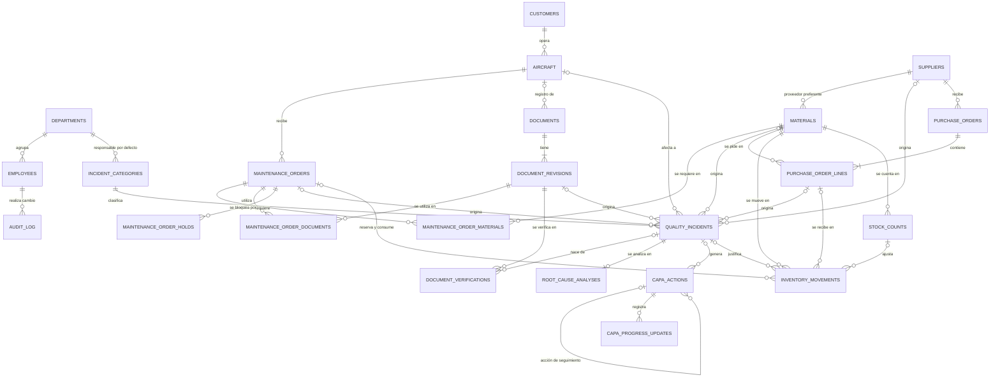

# AQMI — Fase 2: Modelo relacional y diccionario de datos

**Proyecto:** Aviation Quality & Maintenance Intelligence (AQMI)
**Empresa ficticia:** AEROQ MRO
**Documento:** `documentation/02_diccionario_de_datos.md`
**Documento relacionado:** `documentation/03_reglas_de_negocio.md`
**Estado:** Aprobado el 17/11/2026 (actualizado en la Fase 3: `CAPA_Progress_Updates.created_by` y origen de la auditoría; en la Fase 4: tipo de recuento `OPENING`)
**Fecha:** 17/11/2026

> AEROQ MRO es una empresa ficticia y todos sus datos son sintéticos. Los objetivos, plazos y políticas internas descritos aquí son **ficticios** y no representan requisitos normativos.

---

## Índice

1. Cambios respecto a la Fase 1
2. Convenciones de diseño
3. Tipos de datos (SQLite → PostgreSQL)
4. Lo que se guarda y lo que se calcula
5. Diagrama entidad-relación
6. Diccionario de datos (24 tablas)
7. Índices
8. Formatos de los códigos de negocio
9. Orden de carga de las tablas
10. Matriz de trazabilidad de requisitos
11. Cómo revisar esta fase

---

## 1. Cambios respecto a la Fase 1

Durante el diseño detallado han aparecido **dos tablas nuevas** y algunos **campos que pasan de guardarse a calcularse**. Necesitan tu aprobación.

| Cambio | Motivo |
|---|---|
| **Nueva tabla `Maintenance_Order_Holds`** (bloqueos de órdenes) | El KPI *Work Orders Blocked by Material* debe mostrar su evolución mes a mes. Si solo se guarda el estado actual de la orden ("ON_HOLD"), no se sabe cuántas órdenes estaban bloqueadas en marzo. Con esta tabla cada bloqueo tiene inicio, fin, motivo y material o documento causante. Además, permite medir **cuánto dura** cada bloqueo. |
| **Nueva tabla `System_Parameters`** | Las vistas SQL que calculan "caducado" o "vencido" necesitan conocer la fecha de corte. Esa fecha no puede estar solo en un archivo de Python: tiene que estar dentro de la base de datos. |
| **`Maintenance_Order_Documents` con identificador propio** | Facilita el registro de auditoría, que identifica cada registro por un único número. |
| **Campos calculados en lugar de guardados** | Estado de los pedidos, cantidades recibidas, cantidades reservadas y entregadas por orden, empleado activo y estado operativo de la aeronave (detalle en la sección 4). |
| **Los movimientos de almacén no se modifican ni se borran** | Un error se corrige con un movimiento inverso, como en un registro contable. Así el historial nunca se pierde. |

**Total: 24 tablas** (22 de la Fase 1 + 2 nuevas).

---

## 2. Convenciones de diseño

| Elemento | Convención | Ejemplo |
|---|---|---|
| Nombre de tabla | Inglés, palabras con mayúscula inicial unidas por `_`, en plural | `Quality_Incidents` |
| Nombre de campo | Inglés, minúsculas y `_` (*snake_case*) | `detected_date` |
| Clave primaria | `<entidad>_id`, entero | `incident_id` |
| Clave externa | Mismo nombre que la clave primaria a la que apunta; si hay dos hacia la misma tabla, un nombre que explique el papel | `owner_id`, `detected_by` (→ `Employees`) |
| Código de negocio | Campo `*_number` o `*_code`, único y legible | `NC-2025-0042` |
| Fechas | Terminan en `_date` (fecha) o `_datetime` (fecha y hora) | `opened_date` |
| Booleanos | Empiezan por `is_` o `requires_` | `is_controlled` |
| Valores de listas (dominios) | Inglés, MAYÚSCULAS y `_` | `UNDER_INVESTIGATION` |
| Campos de auditoría **[AUD]** | `created_at`, `created_by`, `updated_at`, `updated_by` | — |

**Campos de auditoría [AUD].** Todas las tablas de negocio los incluyen:

| Campo | Tipo | Oblig. | Descripción |
|---|---|---|---|
| `created_at` | DATETIME | Sí | Momento de creación del registro |
| `created_by` | ID → Employees | Sí en tablas de operación / No en tablas maestras | Quién lo creó. En los datos maestros cargados por el sistema puede quedar vacío |
| `updated_at` | DATETIME | No | Momento de la última modificación |
| `updated_by` | ID → Employees | No | Quién hizo la última modificación. Los triggers lo copian a `Audit_Log` |

**Política de borrado.** Ningún registro de negocio se borra físicamente. Las claves externas impiden borrar un registro que otros utilizan y, además, un trigger en cada tabla bloquea cualquier borrado (regla G09). Lo que deja de usarse se cancela, se da de baja o se marca como inactivo.

---

## 3. Tipos de datos (SQLite → PostgreSQL)

SQLite solo tiene cinco tipos reales. Para que los datos sean fiables se usarán **tablas `STRICT`** (SQLite rechaza un texto en un campo entero) y restricciones `CHECK` que comprueban el formato de las fechas.

| Tipo lógico | SQLite | Comprobación en SQLite | PostgreSQL (futuro) |
|---|---|---|---|
| ID | `INTEGER PRIMARY KEY` | Automático | `INTEGER GENERATED ALWAYS AS IDENTITY` |
| CODE | `TEXT` | `GLOB` con el patrón del código | `VARCHAR(n)` + `CHECK` |
| TEXT | `TEXT` | `length()` cuando hay máximo | `VARCHAR(n)` o `TEXT` |
| DATE | `TEXT` (`AAAA-MM-DD`) | `CHECK (date(campo) IS campo)` | `DATE` |
| DATETIME | `TEXT` (`AAAA-MM-DD HH:MM:SS`) | `CHECK (datetime(campo) IS campo)` | `TIMESTAMP` |
| INT | `INTEGER` | Rangos con `CHECK` | `INTEGER` |
| QTY (cantidad) | `REAL` | `CHECK (> 0)` o `(>= 0)` | `NUMERIC(12,3)` |
| MONEY (importe) | `REAL` | `CHECK (>= 0)`; se redondea a 2 decimales al exportar | `NUMERIC(12,2)` |
| BOOL | `INTEGER` | `CHECK (campo IN (0,1))` | `BOOLEAN` |
| ENUM (lista cerrada) | `TEXT` | `CHECK (campo IN (...))` | `VARCHAR` + `CHECK` |

> **¿Por qué `date(campo) IS campo`?** La función `date()` de SQLite devuelve la fecha normalizada o vacío si no es válida. Si el resultado no es idéntico al valor guardado, la fecha está mal escrita (por ejemplo `2025-2-30` o `30/02/2025`) y la base de datos la rechaza.

---

## 4. Lo que se guarda y lo que se calcula

**Principio:** un dato que se puede calcular a partir de otros no se guarda. Si se guardara, tarde o temprano dejaría de coincidir con su origen. Los valores calculados viven en **vistas SQL** (se construyen en la Fase 5).

| Dato | Se calcula a partir de | Vista prevista |
|---|---|---|
| Stock por estado (disponible, reservado, cuarentena, bloqueado, no conforme) | `Inventory_Movements` | `vw_stock_by_bucket` |
| Cantidad reservada, entregada y pendiente por línea de orden; falta de material | `Maintenance_Order_Materials` + `Inventory_Movements` | `vw_mo_material_status` |
| Cantidad recibida y fecha de última recepción por línea de pedido | `Purchase_Order_Lines` + `Inventory_Movements` | `vw_po_line_status` |
| Estado del pedido (enviado, parcialmente recibido, recibido, cancelado) | Líneas + recepciones + `cancelled_date` | `vw_po_status` |
| Vigencia documental (VALID, REVIEW_OVERDUE, OBSOLETE) | Fechas de la revisión + fecha de corte | `vw_document_status` |
| Empleado activo en una fecha | `hire_date` / `termination_date` | `vw_employee_status` |
| Estado operativo de la aeronave (en servicio, en mantenimiento, fuera de contrato) | Órdenes abiertas + fechas del contrato | `vw_aircraft_status` |
| Antigüedad y retraso de las incidencias | Fechas + fecha de corte | `vw_incident_status` |
| Acciones vencidas | `due_date` + estado + fecha de corte | `vw_capa_status` |
| Diferencia de un recuento | `counted_qty − system_qty` | `vw_stock_count_result` |

**Únicas excepciones (fotos históricas que sí se guardan):**

- `Stock_Counts.system_qty`: lo que el sistema decía en el momento del recuento. Es una prueba documental, como un acta. Una validación comprueba que coincide con el stock calculado en ese instante.
- `Maintenance_Orders.status` y `Quality_Incidents.status`: el estado administrativo es una decisión de una persona y no siempre se puede deducir. Las reglas de negocio comprueban que sea coherente con los datos.

---

## 5. Diagrama entidad-relación

*(Se ve como diagrama en GitHub y en VS Code con la extensión "Markdown Preview Mermaid Support".)*

Para no saturar el diagrama no se dibujan las relaciones con `Employees` de cada tabla (responsables, verificadores, campos [AUD]). Están en el diccionario. `System_Parameters` no tiene relaciones. `Audit_Log` apunta a cualquier tabla mediante (`table_name`, `record_id`) sin clave externa física.

---

## 6. Diccionario de datos

**Leyenda:** **PK** clave primaria · **FK** clave externa · **UQ** único · **Oblig.** Sí = no admite vacío (`NOT NULL`).
Las reglas que afectan a varias tablas o a varios registros están en `03_reglas_de_negocio.md` con su código (p. ej. `M05`).

### 6.1 Datos maestros y parámetros

#### `System_Parameters` — Parámetros del sistema

| Campo | Tipo | Oblig. | Clave / restricción | Descripción |
|---|---|---|---|---|
| parameter_key | CODE | Sí | PK | Nombre del parámetro |
| parameter_value | TEXT | Sí | | Valor |
| description | TEXT | Sí | | Para qué sirve |

Parámetros iniciales: `AS_OF_DATE` = 2026-10-31 · `PERIOD_START` = 2024-11-01 · `RANDOM_SEED` · `SCHEMA_VERSION` · `DATA_DISCLAIMER`.

#### `Departments` — Departamentos

| Campo | Tipo | Oblig. | Clave / restricción | Descripción |
|---|---|---|---|---|
| department_id | ID | Sí | PK | |
| department_code | CODE | Sí | UQ; 3 letras mayúsculas | QUA, MNT, PRD, DOC, LOG, DIR |
| department_name | TEXT | Sí | UQ | Quality, Maintenance, Production Planning & Control, Document Control, Logistics & Materials, Management |
| is_active | BOOL | Sí | Por defecto 1 | |
| [AUD] | | | | |

#### `Employees` — Empleados (ficticios)

| Campo | Tipo | Oblig. | Clave / restricción | Descripción |
|---|---|---|---|---|
| employee_id | ID | Sí | PK | |
| employee_code | CODE | Sí | UQ; `EMP-000` | |
| first_name | TEXT | Sí | | Nombre ficticio |
| last_name | TEXT | Sí | | Apellidos ficticios |
| department_id | ID | Sí | FK → Departments | |
| job_title | TEXT | Sí | | Cargo (p. ej. *Quality Inspector*, *Document Controller*, *Production Planner*, *Storekeeper*) |
| is_department_head | BOOL | Sí | Por defecto 0 | Responsable del departamento (aprueba documentos y cierres) |
| email | TEXT | Sí | UQ; termina en `@aeroq-mro.example` | Dominio reservado, que no puede pertenecer a nadie |
| hire_date | DATE | Sí | | Fecha de alta |
| termination_date | DATE | No | `≥ hire_date` | Fecha de baja |
| [AUD] | | | | `created_by` puede estar vacío (carga inicial) |

#### `Customers` — Operadores clientes (ficticios)

| Campo | Tipo | Oblig. | Clave / restricción | Descripción |
|---|---|---|---|---|
| customer_id | ID | Sí | PK | |
| customer_code | CODE | Sí | UQ; `CUS-00` | |
| customer_name | TEXT | Sí | UQ | Nombre ficticio |
| operation_type | ENUM | Sí | HEMS, AERIAL_WORK, PASSENGER_TRANSPORT, PRIVATE | Tipo de operación del cliente |
| country_code | CODE | Sí | 2 letras (ISO 3166-1) | |
| [AUD] | | | | |

#### `Aircraft` — Flota mantenida por AEROQ MRO

| Campo | Tipo | Oblig. | Clave / restricción | Descripción |
|---|---|---|---|---|
| aircraft_id | ID | Sí | PK | |
| registration | CODE | Sí | UQ; `EC-Q00` | Matrícula **imposible en la realidad** (las españolas usan tres letras) |
| fleet_number | CODE | Sí | UQ; `AQ-H00` | Número interno de flota |
| aircraft_category | ENUM | Sí | LIGHT_SINGLE, LIGHT_TWIN, MEDIUM_TWIN | Categoría (decisión D6) |
| aircraft_model | TEXT | Sí | | Designación ficticia (p. ej. `LS-100`, `LT-200`, `MT-300`) |
| serial_number | CODE | Sí | UQ | Número de serie ficticio |
| customer_id | ID | Sí | FK → Customers | Operador |
| year_of_manufacture | INT | Sí | Entre 1990 y 2026 | |
| contract_start_date | DATE | Sí | | Inicio del contrato de mantenimiento con AEROQ MRO |
| contract_end_date | DATE | No | `≥ contract_start_date` | Fin del contrato, si lo hay |
| [AUD] | | | | |

#### `Suppliers` — Proveedores (ficticios)

| Campo | Tipo | Oblig. | Clave / restricción | Descripción |
|---|---|---|---|---|
| supplier_id | ID | Sí | PK | |
| supplier_code | CODE | Sí | UQ; `SUP-000` | |
| supplier_name | TEXT | Sí | UQ | |
| country_code | CODE | Sí | 2 letras | |
| supplier_type | ENUM | Sí | MANUFACTURER, DISTRIBUTOR, REPAIR_STATION, SERVICE_PROVIDER | |
| approval_status | ENUM | Sí | APPROVED, CONDITIONAL, SUSPENDED, INACTIVE | Situación en la **lista interna** de proveedores de AEROQ MRO (no es una aprobación oficial) |
| approval_date | DATE | Sí | | Primera aprobación interna |
| suspended_date | DATE | No | Obligatoria si el estado es SUSPENDED y vacía en caso contrario | |
| next_evaluation_date | DATE | Sí | `≥ approval_date` | Próxima evaluación del proveedor |
| contact_email | TEXT | No | Termina en `.example` | |
| [AUD] | | | | |

#### `Materials` — Catálogo de referencias

| Campo | Tipo | Oblig. | Clave / restricción | Descripción |
|---|---|---|---|---|
| material_id | ID | Sí | PK | |
| part_number | CODE | Sí | UQ; `AQ-0000-00` | Número de pieza **ficticio** |
| description | TEXT | Sí | Máx. 120 caracteres | Descripción genérica (p. ej. "Filtro de aceite – tipo A") |
| material_class | ENUM | Sí | CONSUMABLE, STANDARD_PART, COMPONENT, RAW_MATERIAL | |
| unit_of_measure | ENUM | Sí | EA, L, KG, M, KIT | EA = unidad |
| preferred_supplier_id | ID | Sí | FK → Suppliers | |
| standard_lead_time_days | INT | Sí | `> 0` | Plazo de suministro de referencia |
| min_stock_qty | QTY | Sí | `≥ 0` | Stock mínimo |
| reorder_qty | QTY | Sí | `> 0` | Cantidad que se pide al reponer |
| unit_cost | MONEY | Sí | `≥ 0` | Coste unitario ficticio (EUR) |
| is_serialized | BOOL | Sí | | Cada unidad lleva número de serie |
| is_shelf_life_controlled | BOOL | Sí | | Tiene fecha de caducidad |
| requires_release_certificate | BOOL | Sí | | Su recepción exige referencia de certificado (política interna ficticia) |
| is_active | BOOL | Sí | Por defecto 1 | Referencia en uso |
| [AUD] | | | | |

### 6.2 Módulo E — Órdenes de mantenimiento

#### `Maintenance_Orders` — Órdenes de mantenimiento (control administrativo)

| Campo | Tipo | Oblig. | Clave / restricción | Descripción |
|---|---|---|---|---|
| mo_id | ID | Sí | PK | |
| mo_number | CODE | Sí | UQ; `WO-AAAA-0000` | |
| aircraft_id | ID | Sí | FK → Aircraft | |
| maintenance_type | ENUM | Sí | SCHEDULED, UNSCHEDULED, MODIFICATION | Tipo de mantenimiento |
| work_description | TEXT | Sí | Máx. 200 caracteres | Descripción administrativa del trabajo (sin datos técnicos) |
| priority | ENUM | Sí | ROUTINE, URGENT, AOG | AOG = aeronave en tierra a la espera |
| responsible_department_id | ID | Sí | FK → Departments | |
| planner_id | ID | Sí | FK → Employees | Planificador |
| opened_date | DATE | Sí | | Apertura |
| planned_end_date | DATE | Sí | `≥ opened_date` | Fin previsto |
| actual_end_date | DATE | No | `≥ opened_date`; obligatoria solo si COMPLETED o CLOSED | Fin real |
| status | ENUM | Sí | OPEN, IN_PROGRESS, ON_HOLD, COMPLETED, CLOSED, CANCELLED | |
| closed_date | DATE | No | `≥ actual_end_date`; obligatoria solo si CLOSED | Cierre administrativo tras revisar los registros |
| closed_by | ID | No | FK → Employees; obligatoria solo si CLOSED | Quién revisó y cerró |
| cancellation_reason | TEXT | No | Obligatoria solo si CANCELLED | |
| [AUD] | | | | |

**Ciclo de estados:** OPEN → IN_PROGRESS ⇄ ON_HOLD → COMPLETED → CLOSED. Desde OPEN o IN_PROGRESS → CANCELLED.
COMPLETED significa "trabajo terminado"; CLOSED significa "registros revisados y archivados". Esa revisión es una tarea típica de una oficina de calidad y producción.

#### `Maintenance_Order_Materials` — Materiales necesarios por orden

| Campo | Tipo | Oblig. | Clave / restricción | Descripción |
|---|---|---|---|---|
| mo_material_id | ID | Sí | PK | |
| mo_id | ID | Sí | FK → Maintenance_Orders | |
| material_id | ID | Sí | FK → Materials | |
| qty_required | QTY | Sí | `> 0` | Cantidad necesaria |
| required_by_date | DATE | Sí | Dentro del periodo de la orden (regla M10) | Fecha en la que se necesita |
| [AUD] | | | | |
| | | | **UQ (mo_id, material_id)** | Un material aparece una sola vez por orden |

Cantidades reservadas, entregadas y pendientes: **calculadas** (`vw_mo_material_status`).

#### `Maintenance_Order_Documents` — Documentación utilizada por orden

| Campo | Tipo | Oblig. | Clave / restricción | Descripción |
|---|---|---|---|---|
| mo_document_id | ID | Sí | PK | |
| mo_id | ID | Sí | FK → Maintenance_Orders | |
| revision_id | ID | Sí | FK → Document_Revisions | **Revisión concreta** utilizada |
| usage_role | ENUM | Sí | WORK_INSTRUCTION, TECHNICAL_DATA, FORM, RECORD | Papel del documento en la orden |
| linked_date | DATE | Sí | | Cuándo se asoció a la orden |
| [AUD] | | | | |
| | | | **UQ (mo_id, revision_id)** | |

#### `Maintenance_Order_Holds` — Bloqueos de órdenes *(nueva)*

| Campo | Tipo | Oblig. | Clave / restricción | Descripción |
|---|---|---|---|---|
| hold_id | ID | Sí | PK | |
| mo_id | ID | Sí | FK → Maintenance_Orders | |
| hold_reason | ENUM | Sí | MATERIAL, DOCUMENTATION, OTHER | |
| material_id | ID | No | FK → Materials; obligatorio si el motivo es MATERIAL | Material que falta |
| document_id | ID | No | FK → Documents; obligatorio si el motivo es DOCUMENTATION | Documento que falta o no es válido |
| incident_id | ID | No | FK → Quality_Incidents | Incidencia relacionada, si la hay |
| start_date | DATE | Sí | | Inicio del bloqueo |
| end_date | DATE | No | `≥ start_date` | Fin (vacío = bloqueo activo) |
| comment | TEXT | Sí | | |
| raised_by | ID | Sí | FK → Employees | Quién registró el bloqueo |
| [AUD] | | | | |

Solo puede haber **un bloqueo activo por motivo** en cada orden (índice único parcial).

### 6.3 Módulo C — Control documental

#### `Documents` — Documentos

| Campo | Tipo | Oblig. | Clave / restricción | Descripción |
|---|---|---|---|---|
| document_id | ID | Sí | PK | |
| document_code | CODE | Sí | UQ; `AAA-AAA-000` | P. ej. `PRO-QUA-004` (procedimiento de calidad n.º 4) |
| title | TEXT | Sí | Máx. 150 caracteres | |
| document_type | ENUM | Sí | PROCEDURE, WORK_INSTRUCTION, FORM, TECHNICAL_DATA_REF, AIRCRAFT_RECORD | `TECHNICAL_DATA_REF` es una referencia ficticia, sin contenido técnico |
| owner_department_id | ID | Sí | FK → Departments | Departamento propietario |
| aircraft_id | ID | No | FK → Aircraft; obligatorio si el tipo es AIRCRAFT_RECORD | |
| is_controlled | BOOL | Sí | | Sometido a control de revisiones y vigencia |
| review_interval_months | INT | No | `> 0`; obligatorio si `is_controlled` = 1 | Periodicidad de revisión (**política interna ficticia**) |
| [AUD] | | | | |

#### `Document_Revisions` — Revisiones de cada documento

| Campo | Tipo | Oblig. | Clave / restricción | Descripción |
|---|---|---|---|---|
| revision_id | ID | Sí | PK | |
| document_id | ID | Sí | FK → Documents | |
| revision_code | CODE | Sí | `R00` | Código de revisión |
| revision_seq | INT | Sí | `≥ 0` | Orden numérico de la revisión |
| issue_date | DATE | Sí | | Emisión |
| effective_date | DATE | Sí | `≥ issue_date` | Entrada en vigor |
| review_due_date | DATE | No | `≥ effective_date` | Fecha límite de revisión |
| superseded_date | DATE | No | `≥ effective_date`; obligatoria solo si SUPERSEDED | Fecha en que fue sustituida |
| lifecycle_status | ENUM | Sí | DRAFT, CURRENT, SUPERSEDED, WITHDRAWN | Ciclo de vida |
| prepared_by | ID | Sí | FK → Employees | Autor |
| approved_by | ID | No | FK → Employees; obligatorio salvo en DRAFT; **distinto de `prepared_by`** | Aprobador |
| change_summary | TEXT | Sí | | Qué cambia respecto a la anterior |
| [AUD] | | | | |
| | | | **UQ (document_id, revision_code)** y **UQ (document_id, revision_seq)** | |
| | | | **UQ parcial (document_id) WHERE lifecycle_status = 'CURRENT'** | Una sola revisión vigente por documento |

#### `Document_Verifications` — Verificaciones documentales

| Campo | Tipo | Oblig. | Clave / restricción | Descripción |
|---|---|---|---|---|
| verification_id | ID | Sí | PK | |
| verification_number | CODE | Sí | UQ; `DV-AAAA-0000` | |
| revision_id | ID | Sí | FK → Document_Revisions | Revisión verificada |
| mo_id | ID | No | FK → Maintenance_Orders | Orden afectada, si la verificación es de registros de una orden |
| verification_type | ENUM | Sí | PERIODIC_REVIEW, PRE_USE_CHECK, RECORD_VS_SOURCE, INTERNAL_AUDIT | `RECORD_VS_SOURCE` = comprobar un registro frente a su documento original |
| verification_date | DATE | Sí | | |
| verified_by | ID | Sí | FK → Employees | Quién verificó |
| result | ENUM | Sí | CONFORM, MINOR_DISCREPANCY, NON_CONFORM | |
| discrepancy_description | TEXT | No | Obligatoria si el resultado no es CONFORM | |
| incident_id | ID | No | FK → Quality_Incidents; obligatoria si NON_CONFORM (regla D10) | |
| [AUD] | | | | |

### 6.4 Módulo A — Calidad

#### `Incident_Categories` — Categorías de no conformidad

| Campo | Tipo | Oblig. | Clave / restricción | Descripción |
|---|---|---|---|---|
| category_id | ID | Sí | PK | |
| category_code | CODE | Sí | UQ; 3 letras | |
| category_name_es | TEXT | Sí | UQ | Nombre en español |
| category_name_en | TEXT | Sí | UQ | Nombre en inglés (Power BI y README) |
| description | TEXT | Sí | | Cuándo se usa |
| default_department_id | ID | Sí | FK → Departments | Departamento responsable por defecto |
| is_active | BOOL | Sí | Por defecto 1 | |

| Código | Español | English | Responsable por defecto |
|---|---|---|---|
| DOC | Documentación incorrecta | Incorrect documentation | DOC |
| REC | Error de registro | Recording error | PRD |
| INV | Discrepancia de inventario | Inventory discrepancy | LOG |
| MNC | Material no conforme | Non-conforming material | LOG |
| PRC | Incumplimiento de procedimiento | Procedure non-compliance | QUA |
| TRC | Error de trazabilidad | Traceability error | QUA |
| MNT | Incidencia de mantenimiento | Maintenance issue | MNT |
| SUP | Problema de suministro | Supply problem | LOG |

#### `Quality_Incidents` — No conformidades

| Campo | Tipo | Oblig. | Clave / restricción | Descripción |
|---|---|---|---|---|
| incident_id | ID | Sí | PK | |
| incident_number | CODE | Sí | UQ; `NC-AAAA-0000` | Identificador único |
| category_id | ID | Sí | FK → Incident_Categories | |
| severity | ENUM | Sí | CRITICAL, MAJOR, MINOR, OBSERVATION | Gravedad (**escala interna ficticia**) |
| priority | ENUM | Sí | P1, P2, P3 | Urgencia de tratamiento |
| detection_source | ENUM | Sí | DOCUMENT_VERIFICATION, STOCK_COUNT, RECEIVING_INSPECTION, PRODUCTION, INTERNAL_AUDIT, CUSTOMER, SUPPLIER | Cómo se detectó |
| title | TEXT | Sí | Máx. 120 caracteres | |
| description | TEXT | Sí | | Descripción del problema |
| detected_date | DATE | Sí | | |
| detected_by | ID | Sí | FK → Employees | |
| responsible_department_id | ID | Sí | FK → Departments | |
| owner_id | ID | Sí | FK → Employees | Responsable de la incidencia |
| aircraft_id | ID | No | FK → Aircraft | Objeto relacionado (opcional) |
| mo_id | ID | No | FK → Maintenance_Orders | Objeto relacionado (opcional) |
| revision_id | ID | No | FK → Document_Revisions | Objeto relacionado (opcional) |
| material_id | ID | No | FK → Materials | Objeto relacionado (opcional) |
| supplier_id | ID | No | FK → Suppliers | Objeto relacionado (opcional) |
| po_line_id | ID | No | FK → Purchase_Order_Lines | Objeto relacionado (opcional) |
| containment_action | TEXT | No | Obligatoria si CRITICAL o MAJOR | Acción inmediata de contención |
| status | ENUM | Sí | OPEN, UNDER_INVESTIGATION, ACTION_PLAN, IMPLEMENTATION, EFFECTIVENESS_CHECK, CLOSED, CANCELLED | |
| target_closure_date | DATE | Sí | `≥ detected_date` | Fecha objetivo de cierre (**objetivo interno ficticio**, según gravedad) |
| closed_date | DATE | No | `≥ detected_date`; obligatoria solo si CLOSED o CANCELLED | Fecha de resolución |
| closed_by | ID | No | FK → Employees; obligatorio si CLOSED | |
| closure_summary | TEXT | No | Obligatoria si CLOSED | Medidas adoptadas |
| [AUD] | | | | |

#### `Root_Cause_Analyses` — Análisis de causa raíz

| Campo | Tipo | Oblig. | Clave / restricción | Descripción |
|---|---|---|---|---|
| rca_id | ID | Sí | PK | |
| incident_id | ID | Sí | FK → Quality_Incidents; **UQ** (1:1) | |
| method | ENUM | Sí | FIVE_WHYS, ISHIKAWA, FIVE_WHYS_AND_ISHIKAWA | |
| ishikawa_category | ENUM | No | MANPOWER, METHOD, MATERIAL, MACHINE, MEASUREMENT, ENVIRONMENT; obligatoria si el método incluye Ishikawa | Las "6M" |
| why_1 … why_5 | TEXT | No | `why_1` obligatorio si el método incluye 5 porqués; sin huecos (no puede haber `why_3` sin `why_2`) | Cadena de porqués |
| root_cause_statement | TEXT | Sí | | Causa raíz concluida |
| analysis_date | DATE | Sí | | |
| analyzed_by | ID | Sí | FK → Employees | |
| [AUD] | | | | |

### 6.5 Módulo B — CAPA

#### `CAPA_Actions` — Acciones correctivas y preventivas

| Campo | Tipo | Oblig. | Clave / restricción | Descripción |
|---|---|---|---|---|
| action_id | ID | Sí | PK | |
| action_number | CODE | Sí | UQ; `CA-AAAA-0000` (correctiva) o `PA-AAAA-0000` (preventiva) | El prefijo debe coincidir con el tipo |
| action_type | ENUM | Sí | CORRECTIVE, PREVENTIVE | |
| origin | ENUM | Sí | INCIDENT, TREND_ANALYSIS, INTERNAL_AUDIT | `TREND_ANALYSIS` cubre el "análisis de tendencias" |
| incident_id | ID | No | FK → Quality_Incidents; obligatorio si CORRECTIVE o si el origen es INCIDENT | |
| parent_action_id | ID | No | FK → CAPA_Actions | Acción anterior que resultó no eficaz |
| title | TEXT | Sí | Máx. 120 caracteres | |
| description | TEXT | Sí | | Medida definida |
| responsible_id | ID | Sí | FK → Employees | |
| department_id | ID | Sí | FK → Departments | |
| created_date | DATE | Sí | | |
| original_due_date | DATE | Sí | `≥ created_date` | Fecha límite inicial |
| due_date | DATE | Sí | `≥ original_due_date` | Fecha límite vigente (permite medir reprogramaciones) |
| completed_date | DATE | No | `≥ created_date` | Implantación terminada |
| status | ENUM | Sí | OPEN, IN_PROGRESS, COMPLETED, CLOSED, CANCELLED | |
| effectiveness_check_date | DATE | No | `≥ completed_date` | Verificación de eficacia |
| effectiveness_result | ENUM | No | EFFECTIVE, NOT_EFFECTIVE; obligatorio si CLOSED | |
| effectiveness_comment | TEXT | No | | Evidencia de la verificación |
| verified_by | ID | No | FK → Employees; obligatorio si CLOSED; **distinto de `responsible_id`** | |
| closed_date | DATE | No | `≥ effectiveness_check_date`; obligatoria si CLOSED o CANCELLED | Cierre formal |
| cancellation_reason | TEXT | No | Obligatoria si CANCELLED | |
| [AUD] | | | | |

#### `CAPA_Progress_Updates` — Avances de las acciones

| Campo | Tipo | Oblig. | Clave / restricción | Descripción |
|---|---|---|---|---|
| update_id | ID | Sí | PK | |
| action_id | ID | Sí | FK → CAPA_Actions | |
| update_date | DATE | Sí | | |
| progress_pct | INT | Sí | Entre 0 y 100 | Avance |
| comment | TEXT | Sí | | |
| created_at | DATETIME | Sí | | Momento del registro |
| created_by | ID | Sí | FK → Employees | Quién informó del avance |

Los avances no se modifican ni se borran (regla G08).

### 6.6 Módulo D — Materiales y almacén

#### `Purchase_Orders` — Pedidos a proveedores

| Campo | Tipo | Oblig. | Clave / restricción | Descripción |
|---|---|---|---|---|
| po_id | ID | Sí | PK | |
| po_number | CODE | Sí | UQ; `PO-AAAA-0000` | |
| supplier_id | ID | Sí | FK → Suppliers | |
| order_date | DATE | Sí | | |
| urgency | ENUM | Sí | ROUTINE, URGENT, AOG | |
| buyer_id | ID | Sí | FK → Employees | Comprador |
| cancelled_date | DATE | No | `≥ order_date` | Si se canceló |
| [AUD] | | | | |

Estado del pedido: **calculado** (`vw_po_status`).

#### `Purchase_Order_Lines` — Líneas de pedido

| Campo | Tipo | Oblig. | Clave / restricción | Descripción |
|---|---|---|---|---|
| po_line_id | ID | Sí | PK | |
| po_id | ID | Sí | FK → Purchase_Orders | |
| line_number | INT | Sí | `> 0` | |
| material_id | ID | Sí | FK → Materials | |
| qty_ordered | QTY | Sí | `> 0` | |
| unit_price | MONEY | Sí | `≥ 0` | |
| promised_date | DATE | Sí | `≥` fecha del pedido (regla I05) | Fecha comprometida por el proveedor |
| mo_id | ID | No | FK → Maintenance_Orders | Orden para la que se compra, si es una compra específica |
| [AUD] | | | | |
| | | | **UQ (po_id, line_number)** y **UQ (po_id, material_id)** | |

Cantidad recibida y fecha de recepción: **calculadas** (`vw_po_line_status`).

#### `Inventory_Movements` — Movimientos de almacén *(no se modifican ni se borran)*

| Campo | Tipo | Oblig. | Clave / restricción | Descripción |
|---|---|---|---|---|
| movement_id | ID | Sí | PK | |
| movement_number | CODE | Sí | UQ; `MV-AAAA-00000` | |
| movement_datetime | DATETIME | Sí | | Fecha y hora |
| material_id | ID | Sí | FK → Materials | |
| movement_type | ENUM | Sí | Ver la tabla siguiente | |
| quantity | QTY | Sí | `> 0` | Siempre positiva; el sentido lo dan los estados |
| from_bucket | ENUM | No | QUARANTINE, AVAILABLE, RESERVED, BLOCKED, NON_CONFORMING | Estado de origen (vacío = entra desde fuera) |
| to_bucket | ENUM | No | El mismo dominio | Estado de destino (vacío = sale del almacén) |
| mo_id | ID | No | FK → Maintenance_Orders | |
| po_line_id | ID | No | FK → Purchase_Order_Lines | |
| incident_id | ID | No | FK → Quality_Incidents | |
| stock_count_id | ID | No | FK → Stock_Counts | |
| lot_number | CODE | No | | Lote |
| serial_number | CODE | No | | Número de serie (materiales serializados) |
| certificate_ref | CODE | No | | Referencia **ficticia** del certificado de entrega |
| shelf_life_expiry_date | DATE | No | | Caducidad del lote (materiales con caducidad) |
| reason | TEXT | No | | Motivo (obligatorio en bloqueos y ajustes) |
| performed_by | ID | Sí | FK → Employees | |
| created_at, created_by | | Sí | | Solo creación: el registro no se modifica |

**Matriz de tipos de movimiento** (se aplica con `CHECK`, regla I01):

| Tipo | De | A | Exige |
|---|---|---|---|
| RECEIPT | — | QUARANTINE | `po_line_id`, `lot_number` |
| INSPECTION_RELEASE | QUARANTINE | AVAILABLE | — |
| RESERVE | AVAILABLE | RESERVED | `mo_id` |
| UNRESERVE | RESERVED | AVAILABLE | `mo_id` |
| ISSUE | RESERVED | — | `mo_id`, `lot_number` |
| RETURN | — | QUARANTINE | `mo_id`, `lot_number` |
| BLOCK | AVAILABLE | BLOCKED | `reason` |
| UNBLOCK | BLOCKED | AVAILABLE | `reason` |
| NONCONFORM | QUARANTINE, AVAILABLE o BLOCKED | NON_CONFORMING | `incident_id` |
| SCRAP | NON_CONFORMING | — | `incident_id` |
| ADJUSTMENT_IN | — | AVAILABLE | `stock_count_id`, `reason` |
| ADJUSTMENT_OUT | AVAILABLE | — | `stock_count_id`, `reason` |

El material devuelto de una orden (RETURN) vuelve a cuarentena para ser inspeccionado antes de estar disponible otra vez.

#### `Stock_Counts` — Recuentos físicos

| Campo | Tipo | Oblig. | Clave / restricción | Descripción |
|---|---|---|---|---|
| count_id | ID | Sí | PK | |
| count_number | CODE | Sí | UQ; `SC-AAAA-0000` | |
| material_id | ID | Sí | FK → Materials | |
| count_datetime | DATETIME | Sí | | |
| count_type | ENUM | Sí | OPENING, CYCLE, ANNUAL, AD_HOC | OPENING = saldo inicial contado en la puesta en marcha del sistema (añadido en la Fase 4) |
| system_qty | QTY | Sí | `≥ 0` | Stock disponible según el sistema en ese momento (foto histórica) |
| counted_qty | QTY | Sí | `≥ 0` | Cantidad contada físicamente |
| counted_by | ID | Sí | FK → Employees | |
| comment | TEXT | No | Obligatorio si hay diferencia | |
| [AUD] | | | | |

### 6.7 Módulo F — Auditoría

#### `Audit_Log` — Registro de cambios *(no se modifica ni se borra)*

| Campo | Tipo | Oblig. | Clave / restricción | Descripción |
|---|---|---|---|---|
| audit_id | ID | Sí | PK | |
| event_datetime | DATETIME | Sí | | Momento del cambio |
| table_name | ENUM | Sí | Nombre de una de las tablas de negocio | |
| record_id | INT | Sí | | Identificador del registro afectado |
| action | ENUM | Sí | INSERT, UPDATE, DELETE | DELETE no debería aparecer nunca; si aparece, es una alerta |
| field_name | TEXT | No | Obligatorio si UPDATE | Campo modificado |
| old_value | TEXT | No | | Valor anterior |
| new_value | TEXT | No | | Valor nuevo |
| changed_by | ID | No | FK → Employees | Quién hizo el cambio |
| source | ENUM | Sí | TRIGGER, SYSTEM | TRIGGER = escrito por los triggers; SYSTEM = anotación directa de un script |

**Cómo se rellena (decisión de implementación, Fase 3).** Todos los eventos los escriben los triggers de auditoría. Usan la fecha y el autor del propio registro (`created_at`/`created_by` al crearlo, `updated_at`/`updated_by` al modificarlo) y nunca la hora del ordenador. Así el generador de la Fase 4 no escribe la auditoría a mano: basta con que registre los hechos en orden cronológico, y el historial resultante es el mismo que produciría un sistema real.

---

## 7. Índices

SQLite **no crea índices automáticamente para las claves externas**. Sin ellos, las consultas que unen tablas serían lentas al crecer los datos.

| Tipo de índice | Dónde |
|---|---|
| Único (por restricción UQ) | Todos los códigos de negocio y combinaciones únicas del diccionario |
| Único parcial | `Document_Revisions(document_id) WHERE lifecycle_status = 'CURRENT'` · `Maintenance_Order_Holds(mo_id, hold_reason) WHERE end_date IS NULL` |
| Clave externa | Un índice por cada campo FK (salvo los que ya encabezan un índice único) |
| Fechas de análisis | `Quality_Incidents(detected_date)`, `Maintenance_Orders(opened_date)`, `CAPA_Actions(due_date)`, `Document_Verifications(verification_date)` |
| Compuestos para el cálculo de stock | `Inventory_Movements(material_id, movement_datetime)` · `Inventory_Movements(mo_id, material_id)` |
| Auditoría | `Audit_Log(table_name, record_id, event_datetime)` |

---

## 8. Formatos de los códigos de negocio

| Entidad | Formato | Ejemplo |
|---|---|---|
| Orden de mantenimiento | `WO-AAAA-0000` | WO-2025-0137 |
| No conformidad | `NC-AAAA-0000` | NC-2025-0042 |
| Acción correctiva / preventiva | `CA-AAAA-0000` / `PA-AAAA-0000` | CA-2025-0051 |
| Verificación documental | `DV-AAAA-0000` | DV-2026-0310 |
| Pedido | `PO-AAAA-0000` | PO-2025-0088 |
| Movimiento de almacén | `MV-AAAA-00000` | MV-2026-01544 |
| Recuento | `SC-AAAA-0000` | SC-2025-0120 |
| Documento | `TIPO-DEP-000` | PRO-QUA-004, FRM-PRD-012 |
| Material | `AQ-0000-00` | AQ-2310-04 |
| Aeronave | `EC-Q00` / `AQ-H00` | EC-Q07 / AQ-H07 |
| Empleado / Proveedor / Cliente | `EMP-000` / `SUP-000` / `CUS-00` | EMP-023 |

`AAAA` es el año del registro y la numeración se reinicia cada año.

---

## 9. Orden de carga de las tablas

Una tabla solo puede cargarse cuando ya existen las tablas a las que apunta:

1. `System_Parameters`, `Departments`
2. `Employees`, `Customers`, `Suppliers`, `Incident_Categories`
3. `Aircraft`, `Materials`, `Documents`
4. `Document_Revisions`
5. `Maintenance_Orders`, `Purchase_Orders`
6. `Maintenance_Order_Materials`, `Maintenance_Order_Documents`, `Purchase_Order_Lines`
7. `Quality_Incidents`
8. `Maintenance_Order_Holds`, `Document_Verifications`, `Root_Cause_Analyses`, `Stock_Counts`
9. `CAPA_Actions`, `CAPA_Progress_Updates`, `Inventory_Movements`
10. `Audit_Log`

En la práctica, el generador simula día a día e inserta cada registro cuando "ocurre". Este orden es el de dependencias.

---

## 10. Matriz de trazabilidad de requisitos

Cada requisito del enunciado, con la tabla y el campo que lo cubren.

### Módulo A — Quality Management

| Requisito | Dónde se cumple |
|---|---|
| Registrar no conformidades | `Quality_Incidents` |
| Identificador único | `incident_number` (UQ) |
| Clasificar por categoría (8 categorías) | `category_id` → `Incident_Categories` |
| Niveles de prioridad y gravedad | `priority`, `severity` |
| Departamento responsable | `responsible_department_id` |
| Relacionar con aeronave, orden o documento | `aircraft_id`, `mo_id`, `revision_id` (y además `material_id`, `supplier_id`, `po_line_id`) |
| Fecha de detección | `detected_date` |
| Descripción del problema | `description` |
| Causa raíz | `Root_Cause_Analyses` |
| Responsables | `owner_id`, `detected_by`, `closed_by` |
| Seguimiento del estado | `status` + `Audit_Log` |
| Fecha de resolución | `closed_date` |
| Medidas adoptadas | `containment_action`, `closure_summary`, `CAPA_Actions` |

### Módulo B — CAPA

| Requisito | Dónde se cumple |
|---|---|
| Acciones asociadas a no conformidades | `CAPA_Actions.incident_id` |
| Medidas correctivas y preventivas | `action_type`, `description` |
| Responsables | `responsible_id`, `department_id` |
| Fechas límite | `original_due_date`, `due_date` |
| Registrar avances | `CAPA_Progress_Updates` |
| Acciones pendientes y vencidas | `status` + `due_date` → `vw_capa_status` |
| Verificar la eficacia | `effectiveness_check_date`, `effectiveness_result`, `verified_by` |
| Cierre formal | `status = CLOSED`, `closed_date` |
| 5 porqués / Ishikawa / tendencias | `Root_Cause_Analyses` (`why_1…5`, `ishikawa_category`) · `origin = TREND_ANALYSIS` |

### Módulo C — Document Control

| Requisito | Dónde se cumple |
|---|---|
| Registrar documentos | `Documents` |
| Versión | `Document_Revisions.revision_code` |
| Fechas de emisión y revisión | `issue_date`, `effective_date`, `review_due_date` |
| Vigencia y documentos caducados | `vw_document_status` |
| Quién verificó | `Document_Verifications.verified_by` |
| Trazabilidad de cambios | Cadena de revisiones (`superseded_date`, `change_summary`) + `Audit_Log` |
| Relación con aeronaves y órdenes | `Documents.aircraft_id`, `Maintenance_Order_Documents` |
| Discrepancias entre documentación y registros | `verification_type = RECORD_VS_SOURCE`, `result`, `discrepancy_description` |

### Módulo D — Materials & Inventory

| Requisito | Dónde se cumple |
|---|---|
| Catálogo, identificación, descripción, proveedor | `Materials` |
| Existencias y stock disponible | `vw_stock_by_bucket` |
| Stock mínimo | `min_stock_qty` |
| Entradas, salidas y movimientos | `Inventory_Movements` |
| Pedidos pendientes | `Purchase_Orders` + `vw_po_status` |
| Plazos de suministro | `standard_lead_time_days`, `promised_date` frente a la recepción real |
| Material reservado, bloqueado y no conforme | Estados RESERVED, BLOCKED, NON_CONFORMING |
| Orden bloqueada por falta de material | `Maintenance_Order_Holds` + `vw_mo_material_status` |

### Módulo E — Maintenance & Production Control

| Requisito | Dónde se cumple |
|---|---|
| Aeronave, número, tipo | `aircraft_id`, `mo_number`, `maintenance_type` |
| Fechas de apertura, prevista y real | `opened_date`, `planned_end_date`, `actual_end_date` |
| Estado | `status` + `Maintenance_Order_Holds` |
| Departamento responsable | `responsible_department_id` |
| Documentación asociada | `Maintenance_Order_Documents` |
| Materiales necesarios | `Maintenance_Order_Materials` |
| Incidencias relacionadas | `Quality_Incidents.mo_id` |

### Módulo F — Audit & Traceability

| Requisito | Dónde se cumple |
|---|---|
| Historial de cada incidencia y reconstrucción | `Audit_Log` (`table_name`, `record_id`) + avances + acciones |
| Modificaciones y cambios de estado | `Audit_Log.field_name`, `old_value`, `new_value` |
| Quién realizó cada actuación | `Audit_Log.changed_by` + campos de responsable de cada tabla |
| Relacionar documentos, aeronaves, materiales y órdenes | Claves externas descritas en el diccionario |
| Registros incompletos | Reglas de validación de tipo "WARNING" (p. ej. Q08) |

### Entidades mínimas del enunciado

| Entidad pedida | Tabla del modelo |
|---|---|
| Aircraft, Maintenance_Orders, Quality_Incidents, Documents, Document_Verifications, Materials, Inventory_Movements, Purchase_Orders, Suppliers, Departments, Employees, Audit_Log | Con el mismo nombre |
| Corrective_Actions + Preventive_Actions | `CAPA_Actions` (`action_type`), decisión D1 |

---

## 11. Cómo revisar esta fase

Esta fase no tiene nada que ejecutar. Para aprobarla, comprueba:

1. **Matriz de la sección 10:** que no falte ningún requisito que consideres importante.
2. **Las categorías, estados y listas de valores:** que el vocabulario te resulte natural según tu experiencia en una oficina de calidad.
3. **Las dos tablas nuevas** (sección 1).
4. **Las reglas** de `03_reglas_de_negocio.md`, sobre todo las marcadas como política interna ficticia.

Cuando lo apruebes, en la Fase 3 prepararemos tu ordenador paso a paso y escribiremos el SQL que crea estas tablas.
