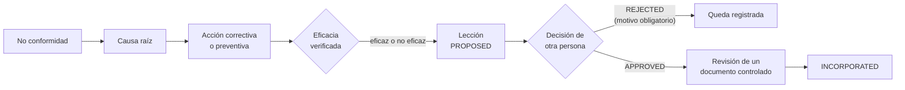

# AQMI — Fase 9 (parte 1): Registro de lecciones aprendidas

**Proyecto:** Aviation Quality & Maintenance Intelligence (AQMI)
**Empresa ficticia:** AEROQ MRO
**Documento:** `documentation/09b_fase9_lecciones_aprendidas.md`
**Estado:** Implementado el 19/11/2026. Decisiones de diseño **aprobadas** el 19/11/2026 (sección 9). Falta la revisión visual en Power BI Desktop, con nuevas capturas y PDF, antes de publicar.

> AEROQ MRO es una empresa ficticia y todos sus datos son sintéticos. El registro de lecciones aprendidas se presenta como una **práctica general de gestión de la calidad** que la empresa aplica de forma voluntaria. **No se presenta como un requisito normativo.** El objetivo del 80 % es un **objetivo interno ficticio** de AEROQ MRO.

---

## Índice

1. Qué se ha construido
2. El ciclo de mejora completo
3. La tabla `Lessons_Learned`
4. Las reglas (grupo L)
5. Cómo se generan los datos sin cambiar nada de lo anterior
6. Resultados
7. El indicador LRN-01
8. Power BI
9. Decisiones tomadas (aprobadas)
10. Archivos creados y modificados
11. Cómo comprobar que funciona
12. Limitaciones

---

## 1. Qué se ha construido

Hasta la Fase 8, el ciclo de calidad terminaba al cerrar la no conformidad: se detecta, se investiga, se actúa, se verifica la eficacia y se cierra. En una oficina de calidad real queda un paso más: **lo aprendido debe llegar a los documentos**, para que el mismo problema no aparezca en otro proceso.

Ese paso es ahora una parte más del sistema:

| Pieza | Qué es |
|---|---|
| Tabla `Lessons_Learned` | El registro de lecciones (tabla 25 de la base de datos) |
| 7 reglas de validación L01–L07 | Controlan el registro; las reglas generales también lo cubren |
| Generador separado | Crea 59 lecciones coherentes **sin tocar ningún dato existente** |
| Vista `vw_lesson_status` | Cada lección con su acción, su no conformidad y los tiempos de cada paso |
| KPI LRN-01 | *Lesson Incorporation Rate*: lecciones aprobadas que ya están en un documento controlado |
| Power BI | Tabla `Fact_Lessons`, 6 medidas nuevas y un bloque *Lessons learned* en la página *Corrective Actions* |
| Caso práctico | NC-2025-0021 termina ahora con su lección, incorporada en FRM-PRD-004 R01 |
| 25 pruebas automáticas | Base de datos, datos generados y pruebas negativas |

## 2. El ciclo de mejora completo



Dos ideas importantes:

- **También se aprende de lo que no funcionó.** Una acción verificada como *no eficaz* (`NOT_EFFECTIVE`) deja siempre una lección. En los datos, las 15 acciones no eficaces tienen la suya.
- **La no conformidad no se guarda dos veces.** La lección apunta a la acción, y la acción a la no conformidad. Así no pueden contradecirse.

## 3. La tabla `Lessons_Learned`

La definición completa, campo a campo, está en el diccionario de datos (`02_diccionario_de_datos.md`, sección 6.5). Resumen:

| Grupo de campos | Campos |
|---|---|
| Identificación | `lesson_number` (`LL-AAAA-0000`, numerado en orden de propuesta), `action_id` (obligatorio) |
| Contenido | `title`, `lesson_text` (qué se aprendió), `recommendation` (qué cambiar) |
| A quién afecta | `department_id` (responsable), `scope` (`DEPARTMENT` o `COMPANY`) |
| Ciclo de vida | `status`, `proposed_date`/`proposed_by`, `approved_date`/`approved_by`, `rejected_date`/`rejected_by`/`rejection_reason` |
| Incorporación | `incorporated_date`, `incorporated_revision_id` (revisión concreta del documento) |
| Auditoría | `created_at`, `created_by`, `updated_at`, `updated_by` |

**Lo que impone la propia base de datos** (restricciones `CHECK`; un registro que no las cumple no se puede guardar):

- APPROVED e INCORPORATED tienen aprobador y fecha de aprobación; REJECTED tiene quien rechaza, fecha y **motivo**; INCORPORATED tiene revisión y fecha de incorporación. Y al revés: una lección propuesta no puede tener datos de decisión.
- Quien aprueba o rechaza no es quien propone.
- Propuesta ≤ decisión ≤ incorporación.
- El formato del número `LL-AAAA-0000`.

**Lo que hacen los triggers**, que se generan solos a partir de la estructura de la tabla (`scripts/trigger_builder.py`): impedir el borrado (G09), obligar a anotar quién y cuándo modifica cada registro, y escribir en `Audit_Log` la creación y cada cambio de campo. Con la tabla nueva hay **90 triggers**.

**Quién hace qué en los datos** (organización ficticia): propone la persona responsable de la acción o quien verificó su eficacia; decide la responsable de Calidad (si la propuesta es suya, decide la Dirección); registra la incorporación el responsable de Control Documental.

## 4. Las reglas (grupo L)

| ID | Regla | Gravedad | Mecanismo |
|---|---|---|---|
| L01 | Solo se propone desde una acción cerrada y con la eficacia verificada, en su fecha de cierre o después | CRITICAL | Validación |
| L02 | Quien aprueba o rechaza no es quien propuso | CRITICAL | CHECK + validación |
| L03 | El estado coincide con la decisión registrada (el rechazo tiene motivo) | CRITICAL | CHECK + validación |
| L04 | Fechas en orden: propuesta, decisión, incorporación | CRITICAL | CHECK + validación |
| L05 | La revisión incorporada es de un procedimiento, instrucción de trabajo o formulario **controlado** | CRITICAL | Validación |
| L06 | La revisión estaba en vigor en la fecha de incorporación y entró en vigor después de la aprobación *(con una excepción aprobada, sección 9)* | CRITICAL | Validación |
| L07 | Lección aprobada sin incorporar más de 90 días (**política interna ficticia**) | WARNING | Validación |

Además, las reglas generales se han ampliado a la tabla nueva: G02 (formato y unicidad del número), G03 (fechas válidas), G04 (nada posterior al corte), G05 (nada anterior al inicio), G06 (las personas estaban de alta), G10 (autor del registro), A01 y A02 (creación y cambios de estado auditados), A03 (cadena de cambios coherente) y A05 (eventos que apuntan a registros existentes).

El catálogo pasa de 82 a **89 reglas**. Cada una está en su archivo de `sql/validation/` (`L01_….sql` a `L07_….sql`).

## 5. Cómo se generan los datos sin cambiar nada de lo anterior

Este era el requisito más delicado del diseño aprobado: los KPI, el caso práctico y las capturas publicadas tenían que seguir siendo válidos.

**Cómo se ha conseguido.** El archivo nuevo `scripts/generator/lessons.py` se ejecuta **después** de la simulación de 24 meses y solo **lee** lo que esta produjo. Tiene su **propio generador de números aleatorios** (semilla 145 + el texto `lessons-learned`). Así, los números que se sortean para las lecciones no alteran la secuencia de la simulación principal.

**Cómo se comprueba.** Una prueba automática (`test_existing_data_did_not_change_since_v1`) calcula una "huella digital" (SHA-256) de las 24 tablas de la v1.0 y la compara con la de la Fase 8. Solo quedan fuera las filas nuevas: los eventos de auditoría de las lecciones y el parámetro `SCHEMA_VERSION`, que pasa de 1.0.0 a 1.1.0. Si cambiara un solo valor de un solo registro, la prueba fallaría. También se ve en Git: en `data/synthetic/Audit_Log.csv` solo se **añaden** líneas al final.

**Cómo decide el generador** (parámetros ficticios en `config/generator_parameters.py`, bloque *Lessons learned*):

| Decisión | Valor |
|---|---|
| Acciones que dejan lección | Todas las no eficaces; un 35 % de las eficaces; siempre la de NC-2025-0021 |
| Plazo de propuesta | 1 a 10 días laborables después del cierre de la acción |
| Plazo de decisión | 3 a 15 días laborables |
| Rechazos | 10 % de las lecciones de acciones eficaces (las de acciones no eficaces nunca se rechazan) |
| Alcance de toda la empresa | 25 % (se incorporan en un procedimiento de Calidad) |
| Incorporación | En la primera revisión de un documento controlado del departamento que entra en vigor después de la aprobación (en los 180 días siguientes). Si no la hay, la lección queda pendiente. Un 15 % queda pendiente aunque la haya |

**Historia de NC-2025-0021.** Su lección (*Mandatory fields must be evident on forms*, alcance toda la empresa) se incorpora en **FRM-PRD-004 R01**, el formulario rediseñado que fue la propia acción correctiva.

## 6. Resultados

| Dato | Valor |
|---|---|
| Lecciones | 59 (44 de acciones eficaces, 15 de no eficaces) |
| Incorporadas | 40, en 22 revisiones de documentos |
| Aprobadas pendientes de incorporar | 12 (10 de ellas con más de 90 días: aviso L07) |
| Rechazadas, con motivo | 7 |
| Alcance | 40 de departamento, 19 de toda la empresa |
| Tiempo medio hasta la decisión | 12,8 días |
| Tiempo medio desde la aprobación hasta la incorporación | 67,2 días |
| Puerta de calidad | **PASSED**: 89 reglas, 0 fallos críticos, 9 de 9 discrepancias sembradas detectadas, Data Quality Score 89,9 % |
| Eventos de auditoría nuevos | 363 (en total, 17.746) |

El Data Quality Score baja de 90,2 % a 89,9 % solo porque hay más reglas y una de ellas (L07) tiene avisos: las 82 reglas anteriores dan exactamente el mismo resultado.

## 7. El indicador LRN-01

| | |
|---|---|
| **Nombre** | Lesson Incorporation Rate (Lecciones aprendidas incorporadas) |
| **Qué mide** | De las lecciones aprobadas hasta la fecha, qué porcentaje ya está incorporado a un documento controlado |
| **Fórmula** | Lecciones con `incorporated_date` ≤ fecha ÷ lecciones con `approved_date` ≤ fecha × 100 (foto a fecha) |
| **Tablas** | `Lessons_Learned`, `Document_Revisions` |
| **Frecuencia** | Mensual |
| **Objetivo** | ≥ 80 %, alerta por debajo de 60 %. **Objetivo interno ficticio de AEROQ MRO** |
| **Valor en la fecha de corte** | **76,9 %** (40 de 52): ámbar |
| **Evolución** | 44,0 % en el primer año y 76,9 % en el segundo |
| **Interpretación** | Si lo aprendido llega de verdad a los documentos o se queda en el registro |
| **Limitaciones** | No cuenta las lecciones rechazadas ni las pendientes de decisión. Una aprobación reciente baja el valor aunque esté en plazo. No mide la calidad del cambio introducido |

El catálogo tiene ahora **19 indicadores**. LRN-01 está en un área nueva, *Continuous improvement*, y va al final del catálogo, de modo que los 18 anteriores no cambian ni de valor ni de orden. La regla K05 lo comprueba: la foto reconstruida en la fecha de corte coincide con el estado actual del registro. La conciliación K03 (Power BI = SQL) pasa a 19 indicadores.

## 8. Power BI

**Modelo.** Tabla nueva `Fact_Lessons` (una fila por lección), relacionada con `Dim_Date` por la fecha de propuesta y con `Dim_Department`. Medidas nuevas en la carpeta `8. Lessons Learned`:

| Medida | Qué devuelve |
|---|---|
| `Lessons Proposed` | Lecciones propuestas en el periodo |
| `Lessons Approved` | Lecciones aprobadas al final del periodo |
| `Lessons Incorporated` | De ellas, las ya incorporadas |
| `Lesson Incorporation Rate` | LRN-01 |
| `Lessons Pending Incorporation` | Aprobadas sin incorporar |
| `Lesson Days Pending` | Días de espera de cada lección pendiente (para la tabla) |

`KPI Value (Power BI)` incluye LRN-01, así que la tabla de conciliación de la página *Audit & Traceability* compara ahora 19 indicadores. El modelo tiene **87 medidas**.

**Página Corrective Actions.** La franja inferior se divide en dos:

- a la izquierda, la tabla *Open actions* (sin la columna *Type*, porque el prefijo CA/PA ya la indica);
- a la derecha, el bloque *Lessons learned*: dos tarjetas (LRN-01 y lecciones pendientes) y una tabla con cada lección, su estado, el documento en el que está incorporada y los días de espera, con las pendientes primero.

**Cómo se ha modificado el proyecto.** Se respetan las convenciones de la versión guardada por Power BI Desktop. Los cambios son mínimos (7 archivos modificados y 3 nuevos) y siguen sus convenciones: `lineageTag` en la tabla, las columnas y las medidas nuevas; finales de línea CRLF; JSON sin salto final; y `compatibilityLevel` 1606, `cultures/en-US.tmdl` y el esquema del informe 3.3.0 sin tocar. Los mismos cambios están en `scripts/build_powerbi_project.py`, y el validador comprueba los dos proyectos contra los esquemas oficiales de Microsoft. **Falta abrirlo en Power BI Desktop** (en tu ordenador) para ver cómo queda, ajustar el bloque si hace falta y rehacer las capturas y el PDF.

## 9. Decisiones tomadas (aprobadas)

Durante la implementación surgieron nueve puntos que el diseño aprobado no resolvía. Se propusieron con su alternativa y se **aprobaron el 19/11/2026**. Cada una está en un solo sitio, por si hubiera que revisarla.

| # | Decisión aprobada | Dónde está |
|---|---|---|
| 1 | **Regla L06 con excepción.** FRM-PRD-004 R01 entró en vigor el 07/05/2025, antes de que se verificara la acción (20/05/2025), porque el rediseño *era* la acción. L06 acepta la revisión producida por la propia acción (en vigor entre su creación y su cierre). Para el resto de lecciones la regla es estricta | `sql/validation/L06_lesson_revision_in_force.sql` |
| 2 | LRN-01 en un **área nueva**, *Continuous improvement* (en lugar de *Quality*) | Cabecera de `sql/kpi/LRN01_…sql` y `AREAS` en `scripts/run_kpis.py` |
| 3 | Campos de **rechazo propios** (`rejected_date`, `rejected_by`) además del motivo, para no usar `approved_by` en un rechazo | Diccionario y `sql/schema/01_tables.sql` |
| 4 | `department_id` **siempre obligatorio** (departamento responsable), también cuando el alcance es toda la empresa | Ídem |
| 5 | **Diseño del bloque** en *Corrective Actions* y retirada de la columna *Type* de *Open actions* | `page_content("p03capa")` y los `visual.json` de la página |
| 6 | Plazo de **90 días** para el aviso L07 (política ficticia) | `sql/validation/L07_…sql` |
| 7 | `SCHEMA_VERSION` 1.0.0 → **1.1.0** | `config/settings.py` |
| 8 | **Quién decide** en los datos generados: propone el responsable de la acción o quien verificó su eficacia; decide la responsable de Calidad (o la Dirección, si la propuesta es suya); registra la incorporación Control Documental. Parámetros ficticios de la sección 5 | `scripts/generator/lessons.py`, `config/generator_parameters.py` |
| 9 | **Publicación:** se publica en GitHub después de abrir el `.pbip` en Power BI Desktop, revisar el bloque nuevo y rehacer las capturas y el PDF, para que el README nunca muestre una captura antigua | — |

## 10. Archivos creados y modificados

**Nuevos**

| Archivo | Contenido |
|---|---|
| `scripts/generator/lessons.py` | Generador de lecciones |
| `sql/validation/L01_…` a `L07_…` | Las 7 reglas del grupo L |
| `sql/views/12_vw_lesson_status.sql` | Vista de estado de las lecciones |
| `sql/kpi/LRN01_lesson_incorporation_rate.sql` | Indicador LRN-01 |
| `sql/analytics/25_Fact_Lessons.sql` | Tabla de hechos para Power BI |
| `data/synthetic/Lessons_Learned.csv`, `data/processed/Fact_Lessons.csv` | Datos exportados |
| `powerbi/…/tables/Fact_Lessons.tmdl`, `…/p03capa/visuals/lessonCards/`, `…/lessons/` | Power BI |
| `tests/test_lessons_learned.py` | 25 pruebas |
| `documentation/09b_fase9_lecciones_aprendidas.md` | Este documento |

**Modificados:** `sql/schema/01_tables.sql` y `02_indexes.sql` (y `03_triggers.sql`, que se regenera solo), `config/settings.py`, `config/generator_parameters.py`, `scripts/generate_data.py`, `run_validations.py`, `run_kpis.py`, `build_powerbi_project.py`, `build_case_study.py`, `sql/queries/01_nonconformity_full_history.sql`, `sql/analytics/24_Fact_AuditEvents.sql`, 10 reglas generales (G02–G06, G10, A01–A03, A05), 7 archivos del proyecto Power BI, las pruebas con recuentos, la integración continua, el README, el caso práctico y los documentos 02, 03, 07 y 08.

## 11. Cómo comprobar que funciona

Desde la carpeta principal del proyecto, con el entorno virtual activado:

```powershell
python scripts/run_pipeline.py
```

Al final debe aparecer `Lessons learned generated: 59`, `Rules: 89 | passed: 80 | warnings: 9 | critical failures: 0`, `LRN-01 Lesson Incorporation Rate 76.9 % AMBER`, `QUALITY GATE PASSED`, `KPI CHECKS PASSED` y `PIPELINE OK`.

```powershell
python -m pytest -q
```

Debe terminar con `177 passed`.

```powershell
python -m pytest -q tests/test_lessons_learned.py
```

Ejecuta solo las 25 pruebas de esta parte, entre ellas la que demuestra que los datos de la v1.0 no han cambiado.

**En DB Browser for SQLite**, para ver el registro:

```sql
SELECT lesson_number, status, scope, title, incorporated_in, days_pending
FROM vw_lesson_status
ORDER BY lesson_number;
```

**En Power BI Desktop:** abrir `powerbi/AQMI.pbip`, pulsar **Actualizar** e ir a *Corrective Actions*. El bloque *Lessons learned* debe mostrar 76.9% y 12 pendientes. En *Audit & Traceability*, la tabla K03 debe mostrar 19 filas con «✔ Match».

## 12. Limitaciones

- Las revisiones que incorporan lecciones son revisiones periódicas **que ya existían** en los datos. No se han creado revisiones nuevas para no modificar datos existentes, así que su `change_summary` no menciona la lección. La relación queda registrada en la lección, que es donde se consulta.
- Los textos de las lecciones salen de un catálogo por categoría de no conformidad: son coherentes, pero repetitivos.
- No hay una pantalla para proponer o aprobar lecciones; como el resto del sistema, la actividad la produce el generador.
